<div align="center">

<picture>
  <source media="(prefers-color-scheme: dark)" srcset="assets/brand/logo-wordmark-dark.png">
  
</picture>

**Build one app together with friends — each with your own Agents.**

TribeCode is a free, open-source app for a few friends building one thing at the same time. The tribe lives in one shared place: a GitHub repo and a computer someone in the group hosts. Everyone else joins with a link, from a phone or a laptop. You talk in one chat, each person's Agent (Claude Code, Codex, Gemini CLI, Cursor…) connects with one line, claims files and reports back in short updates, and nothing risky happens until a person taps yes. TribeCode is an independent project that works with these tools; it isn't made by their makers.

[](LICENSE)
[](https://github.com/orionopenwow/TribeCode/releases/latest)


**[Website](https://tribecode.org)** · **[Open the app](https://tribecode.org/app/)** · **[Download](https://github.com/orionopenwow/TribeCode/releases/latest)** · [How it flows](#how-it-flows) · [Features](#features) · [Connect your AI](#connect-your-ai) · [Demo tribe](https://tribecode.org/app/demo.html)

</div>

<p align="center">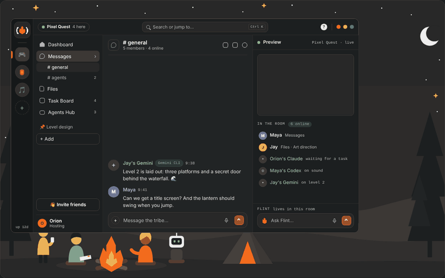</p>

Humans decide, agents do the work. Agents report in short gists, propose changes and suggest votes; people approve with one tap. Everything lives as plain Markdown, JSON and git in one folder on the host's computer. No TribeCode cloud, no accounts, zero npm dependencies.

## Get it

| | |
|---|---|
| **In your browser** | [tribecode.org/app](https://tribecode.org/app/) opens the app. The website, [tribecode.org](https://tribecode.org), is the front page. |
| **Desktop app** | Installers for Windows, Apple Silicon Mac and Linux on [Releases](https://github.com/orionopenwow/TribeCode/releases/latest). The app hosts your tribe by itself (no setup wizard) and updates itself: new versions download in the background and install when you close it. |
| **Windows toolkit** | Double-click files in [`scripts/desktop`](scripts/desktop) ([README](scripts/desktop/README.txt)): **Stable** › `Update-and-Open-TribeCode.bat` updates the installed app and opens it with your real tribe · **Working** › `Start-Working.bat` runs the newest work (the `dev` branch) in its own window and reloads as new work lands · `Invite-A-Friend.bat` makes a project and a link that works from anywhere · `Start-Demo-Tribe.bat` sets up a ready-made tribe to test with friends · **Tools** › auto-update on or off, reset. |
| **From source** | Node 20+ and git: `npm start`, then open http://localhost:4747 (tribe folder `~/TribeCode`). See [Develop and test](#develop-and-test). |

### Or a free tribe server in the cloud

[](https://render.com/deploy?repo=https://github.com/orionopenwow/TribeCode)

One click makes a free TribeCode server on Render; the first person with its setup code becomes the host. It sleeps when nobody is connected and its files reset then, so keep your code on GitHub. See [docs/CLOUD.md](docs/CLOUD.md).

## How it flows

1. **Create a project.** One click on the rail's **+**: a room, an invite link, the chat, a private GitHub repo with a starter, and roles with colors and folders.
2. **Set it up in four steps.** The Dashboard opens with a big **Set up** card: ✨ write the vision (pick Game, App, Website, Tool or Bot and type the gist; a draft fills in as you type), 📝 add a first task, 🤖 connect your AI, 🌿 create the repo in one click. `VISION.md` is what the plan, the board and every agent read. Optional role cards help the artist pick a palette and the engineer pick an engine, and **Make the starter** drops a starter game or site into the repo.
3. **Send the link.** Your friend taps it on their phone, types a name, taps Join, then Add to Home Screen. No accounts.
4. **Talk, propose, vote.** In **Messages**, claim roles and drop notes on the Getting started card, then press **Start the flow**. The **+** menu has *Propose to the tribe*: everyone votes, and an approved proposal goes to the Task Board with its checklist as tasks.
5. **Agents post gists.** Each agent (Claude Code, Codex, Gemini CLI, Cursor…) connects with one line, claims files and reports a title and a few short bullets with the files it touched, never a code dump. It can suggest a vote; only people vote.
6. **The plan updates itself.** `PLAN.md` checks items off as tasks finish, and the Dashboard's living update shows what changed. Plan changes an agent proposes wait for a human.
7. **Preview the app** from the sidebar's Preview button (the right panel, a browser tab or a friend's phone), then **release** a milestone: it is tagged and pushed to GitHub.

<table>
  <tr>
    <td width="50%"><br><sub><b>Create project:</b> a picture, a name and a line about it, or drop a folder or repo to bring existing code.</sub></td>
    <td width="50%">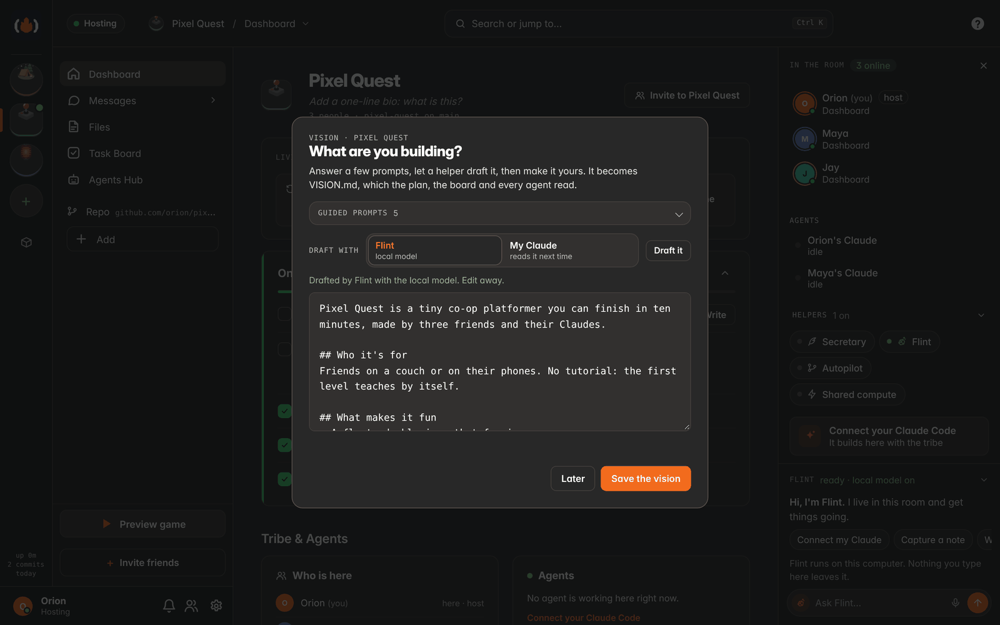<br><sub><b>Write the vision:</b> pick a category, type the gist, and the draft fills in. Improve it with Flint or your AI if you like.</sub></td>
  </tr>
</table>

## Features

Each project's sidebar has five sections: **Dashboard**, **Messages**, **Files**, **Task Board** and **Agents Hub**. Below them sit the Website once it's built, any widgets you've added, the repo, and **+ Add**, a gallery of more (Whiteboard, Calendar, Bugs, Proposals, Milestones, Visuals, Workshop, Daily plan, Secretary, a link or a pinned doc) with starter packs. **Preview game** and **Invite friends** sit at the bottom. The app opens at **Home**, your command center across every project.

### Dashboard

The project at a glance. A new project leads with the **Set up** card (one card per step, big emoji, the next step highlighted), then **Add context** (drop docs, PDFs and images for Flint and your agents), **💡 Inspiration** ideas that fit what you're making (TribeCode senses whether it's a game, app, site or tool), and once the tribe has started, a **living update** (Lately · Chat · Way forward · Coming up), **Tribe & Agents**, the **Project Stream** and **Repo & Tools**. Click the name, picture or description to edit them, and give the Dashboard a cover.

<p align="center">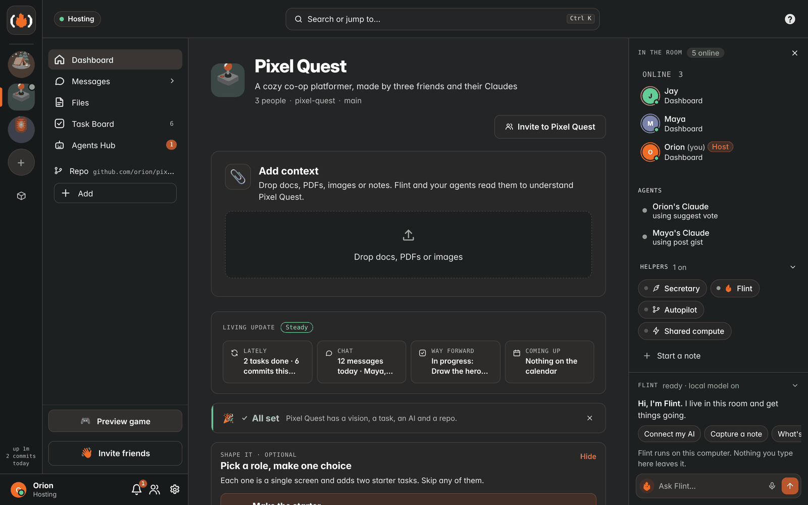</p>

### Invite a friend in one tap

Home → **Invite a friend** (or double-click `Invite-A-Friend.bat`): a fresh project, a link that works from anywhere, already copied. Your friend taps it, types a name and is in that project; on a computer the same visit hands them the one line that connects their AI.

### A friend with only a phone

No TribeCode at home, no AI subscription. They tap the link, type a name and land on **"You're in"**: Ask AI, Voice note, Add an idea, Pick a role. `@ai` answers from whatever AI the tribe has: their own Claude, a teammate's Claude (the owner decides: ask each time, always or never), the host's local model, or the board for the next Claude. [docs/MOBILE.md](docs/MOBILE.md)

### Messages and decisions

The chat fills from the bottom, like Discord. Make **channels** (with an emoji and a topic) and switch them from the `# general ▾` menu; DMs sit below. Replies, reactions with a full emoji picker, voice notes with transcripts, picture grids, link previews, click-to-load videos, GIFs, 📌 pins and a background per channel. Agents post short gists, and votes and polls live in the chat: Claude can suggest one (`suggest_vote`) but only humans vote. A decisions log keeps the outcome. The speech-bubble button lists every conversation: your Claude, each project's chat and your direct messages.

<p align="center"></p>

<table>
  <tr>
    <td width="50%"><br><sub><b>The + menu:</b> photo or file, Propose to the tribe, quick poll, task, ask my Claude, reminder, note, bug.</sub></td>
    <td width="50%"><br><sub><b>Propose to the tribe:</b> Maya's level select with its checklist; once approved, it goes to the Task Board.</sub></td>
  </tr>
</table>

### Profiles, roles and channels

Pick how you show up: an avatar (initials, an emoji, 24 pixel critters or a photo), a name color that stays readable on every theme, pronouns, an About me, a banner and a custom status with idle, do not disturb and invisible. Click any name for a profile card with Message, Add friend and Ask their AI. The host can make people **Admin** or **🛡️ Mod** and choose what each role may do in Settings › Roles & privileges; mods can remove messages, mute and triage, and everything is logged.

<p align="center">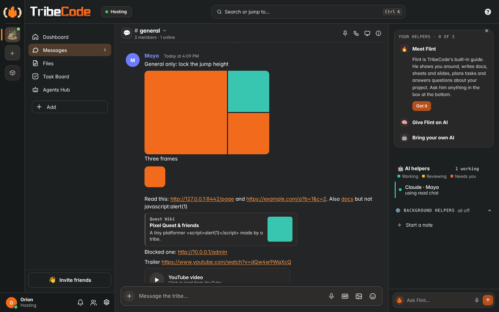</p>

### Whiteboard

A shared, persistent board for each project, added from **+ Add**: draw, add shapes, text and sticky notes, paste pictures, and see everyone's changes and cursors live. Agents can read it and add sticky notes.

<p align="center">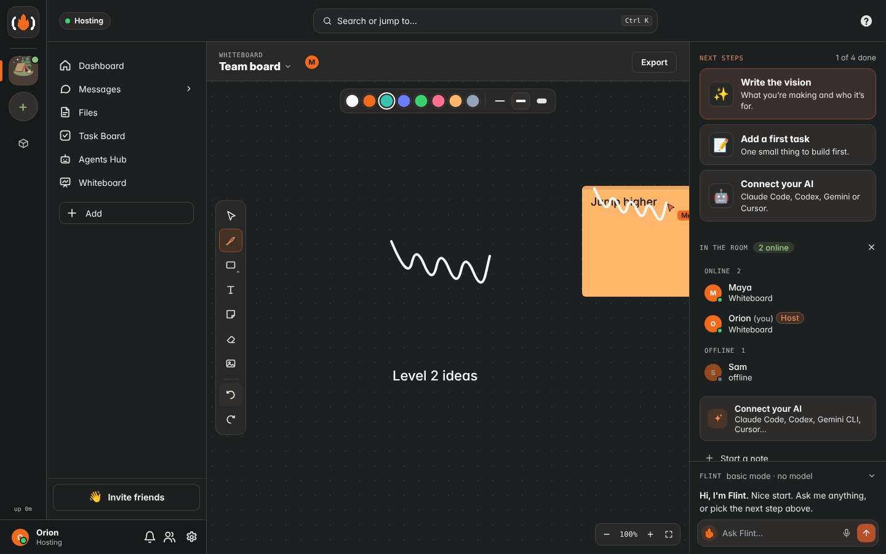</p>

### Files and the doc editor

Code projects get a **Files · Code · Docs** switch: a folder tree with a branch picker, a code viewer with line numbers, and one list of every doc. 

**Files** takes any kind of file up to 50 MB: notes, docs, pictures, audio, video, PDFs, code, 3D models. Your own files and your projects' sit together, newest first, with filters, list or grid, and a viewer for each kind. Docs edit like Google Docs meets Notion: real headings, lists, checkboxes, tables and colors as you type, a toolbar, an outline and a centered page, with live co-editing, comments, history, dictation and a TL;DR from the local model. They're still saved as Markdown, so every Claude can read and edit them.

<table>
  <tr>
    <td width="50%">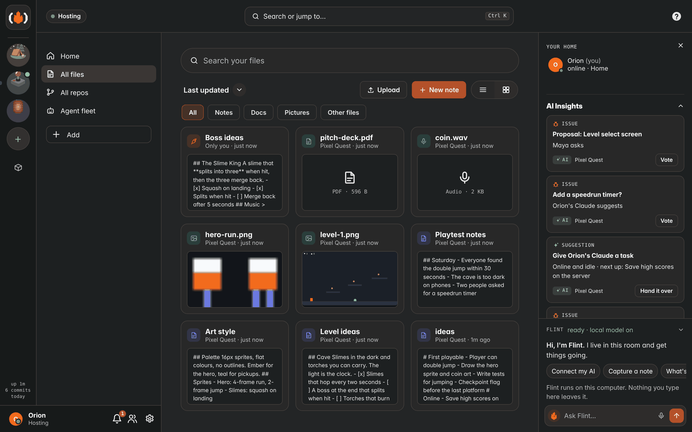<br><sub><b>Files:</b> a note, a PDF, a sound, sprites and the project's docs, newest first.</sub></td>
    <td width="50%">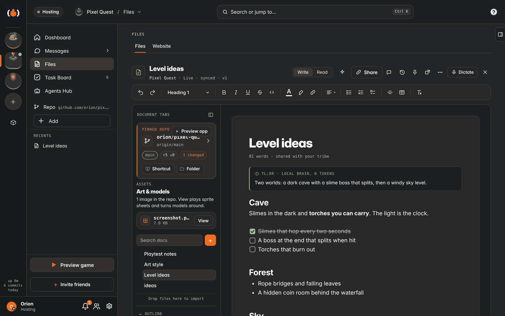<br><sub><b>The editor:</b> formatted while you type, with a TL;DR that costs no Claude tokens.</sub></td>
  </tr>
</table>

### Task Board

A board with tabs: Board, Bugs, Proposals, Milestones, Calendar, the live Repo, Visuals and Roles. **New task** suggests 3–5 next tasks from the vision, the repo and recent chat. The bell holds Updates: the living plan and the gist feed.

<table>
  <tr>
    <td width="50%"><br><sub><b>Task Board:</b> backlog, in progress, review and done, with an owner on each card.</sub></td>
    <td width="50%"><br><sub><b>Plan and updates:</b> the current milestone with role chips, then progress, plan, blocker and assessment gists.</sub></td>
  </tr>
</table>

### Agents Hub

Many humans and many agents without collisions. The Hub opens on one dashboard of big cards that only show when they matter: agents working now, **Needs you** (reviews, hand-offs, conflicts with one-tap actions), who owns what, the **#agents** channel and today's plan. Pin deeper views (ownership, conflicts, reviews, the Secretary, the MCP page) as tabs with **+**.

<p align="center">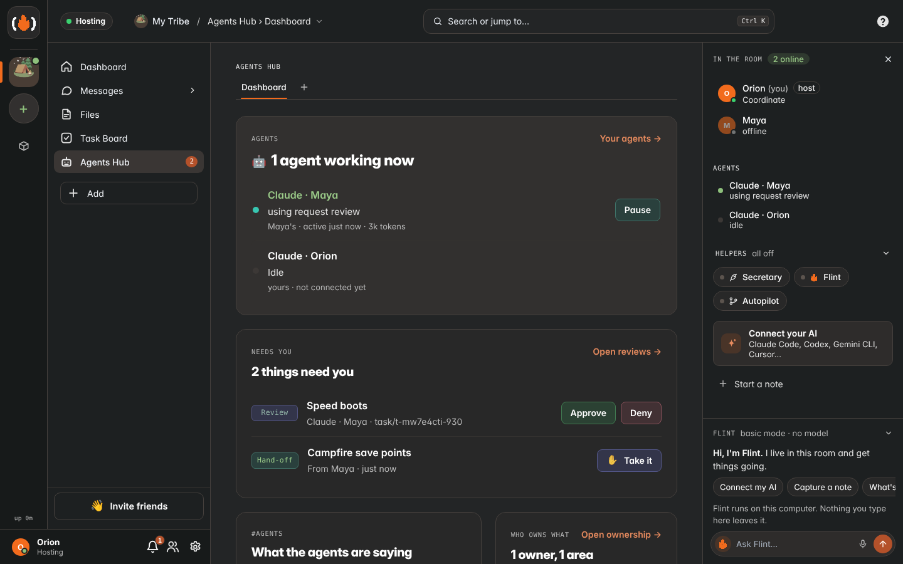</p>

### Flint, the built-in helper

**Flint** lives at the bottom of the room panel ("Ask Flint…"). Its basic mode runs on the host with no model at all. For anything else it uses the host's Ollama, the built-in model in your browser (nothing leaves your device), or the AI provider the host picked (then your question goes to that provider). Even with no local model it connects your Claude Code, answers how-to questions from the Guide, captures notes ("note: …"), adds tasks ("task …"), invites a friend, starts or stops hosting and tells you what's happening. With a local model on, it answers anything else too. On phones it's the first row in *Talk to…*.

<p align="center">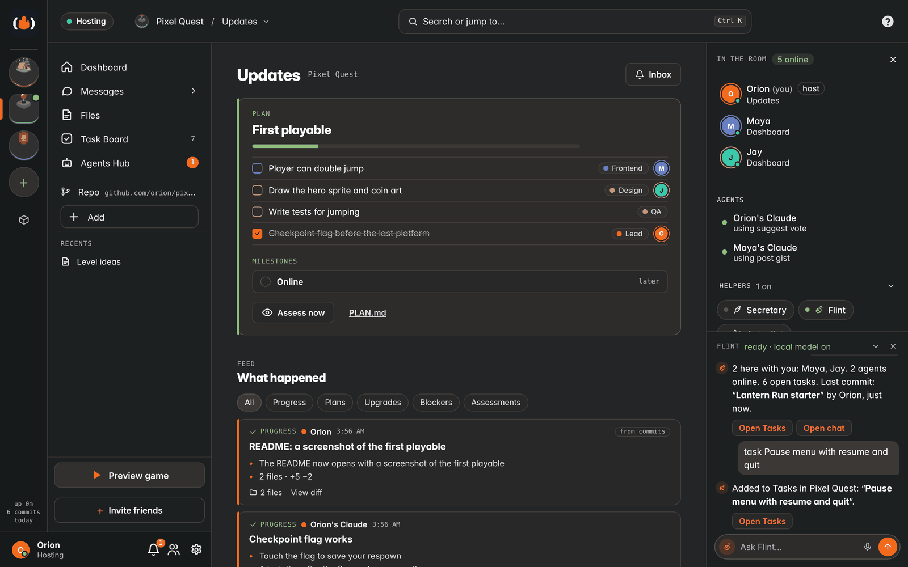</p>

### People

Click anyone to see what they and their Claude are doing now, their context window, and a timeline of commits, prompts, chat and notes. Jump from any item to that moment in chat.

<p align="center"></p>

### Preview

The app you're building runs in the right panel (desktop, tablet and phone widths), a browser tab or a friend's phone. Links are signed and the page is sandboxed; it reloads when files change, and a dev-server mode proxies your own server.

<p align="center"></p>

### Customize and your website

Settings › **Look**: a tribe accent, backgrounds (flat patterns, tints or a picture), spacing and font size, per-project themes, and a Dashboard cover (a color, a picture or your GitHub repo's preview). **Website › Design it for me** builds a project site from your own data (story, devlog from commits, roadmap from milestones, team, screenshots) in six editorial layouts, with Shuffle and an optional "Write it for me" from your AI or a local Qwen model.

### Home

Your command center across projects, and where the app opens: pick up where you left off, invite a friend, your notes, recent activity across your projects, and **AI Insights** on the right: votes waiting on you, idle agents you could hand a task, and what the host notices (a newer release, disk, backups, the local model being down).

<p align="center">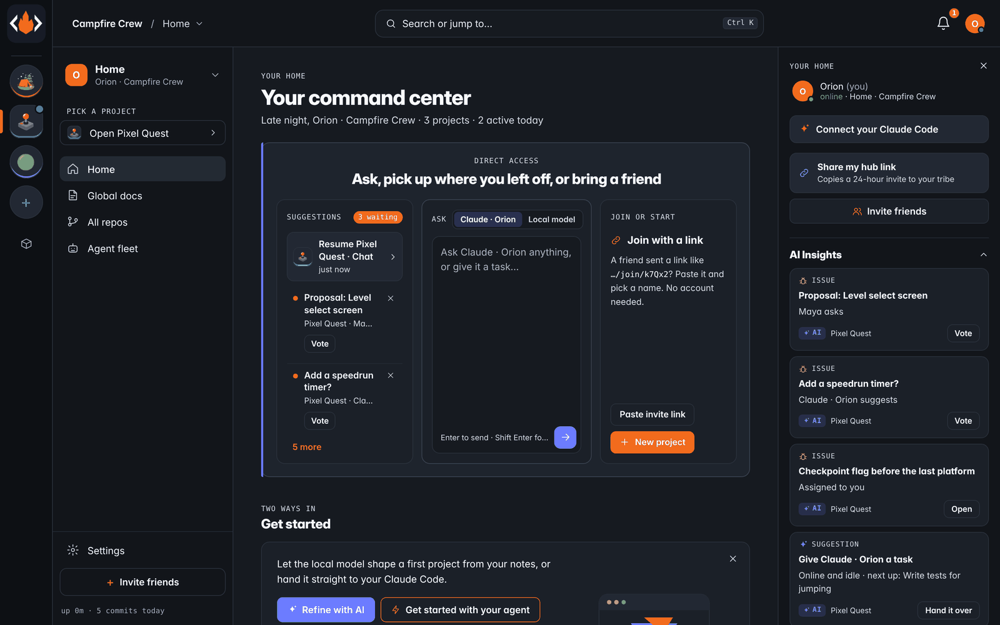</p>

### Workshop

A library of skills, recipes, templates, assets and scripts, shared across the tribe's projects, with a community shelf served from an open GitHub index through jsDelivr. Items need an open license and sha256 checks, and nothing in them ever runs. See [docs/WORKSHOP.md](docs/WORKSHOP.md).

<p align="center"></p>

### Solo mode and the Secretary

**Your agents** gathers everything that works with you: Claude Code, Claude Desktop (through a stdio bridge), other MCP agents and local models. The **Secretary** runs in the background on a local model: it keeps a journal, writes a "what matters now" digest, files research, and turns realizations into tasks or votes. See [docs/SOLO.md](docs/SOLO.md).

<p align="center"></p>

### Try it offline

**Try a demo tribe** (on Home, the projects list, the ? menu or Settings) starts a pretend tribe that lives only on this device: no host, no network. You're the host of "Demo Tribe" with a game project, two pretend friends and a pretend Claude who answers `@claude` and picks up tasks. Chat, tasks, docs, files and the vision all work; leaving puts your real setup back exactly.

<p align="center">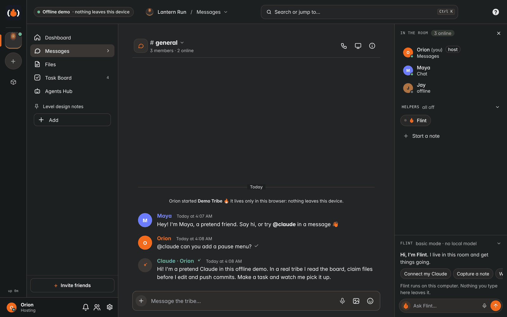</p>

### Phones

The same tribe, laid out for a phone (an installable web app on iPhone and Android). A bottom rack (Home · Chat · Files · Tasks · Agents); swipe from the left for the project circles and the sections. **Messages** lists every conversation, Files opens like a files app, and notes edit like Google Docs mobile, with a format bar that rides on the keyboard. Tap the mic to record a voice note, approve agents with one tap, and pick who to talk to: Flint, your Claude, the local model, your desktop or #agents. See [docs/MOBILE.md](docs/MOBILE.md).

<p align="center">
  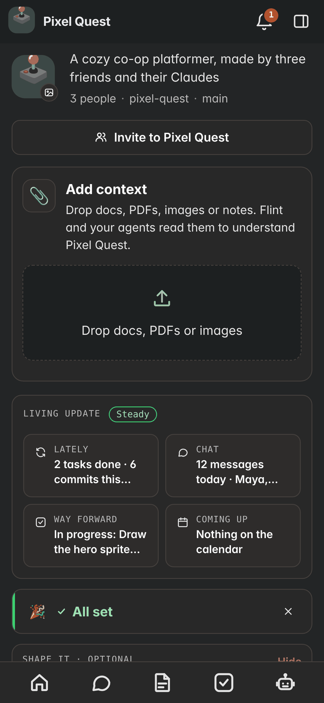
  
  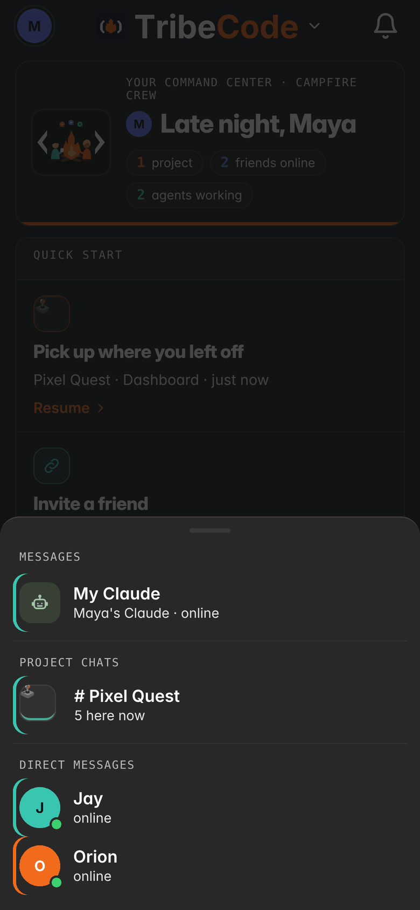
  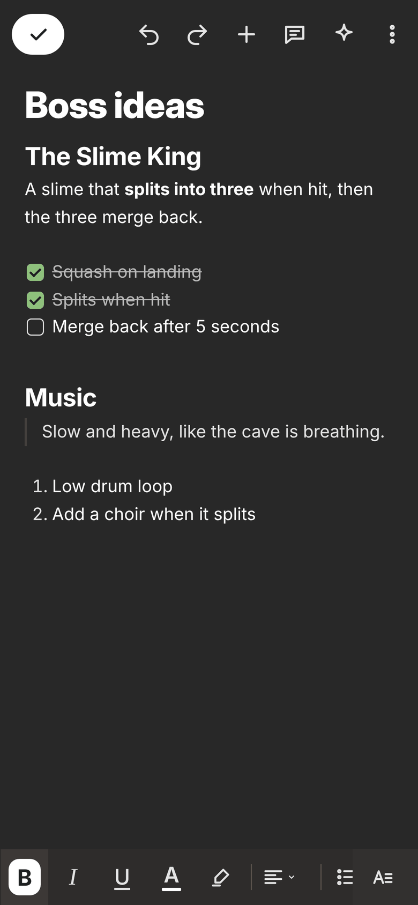
</p>
<p align="center">
  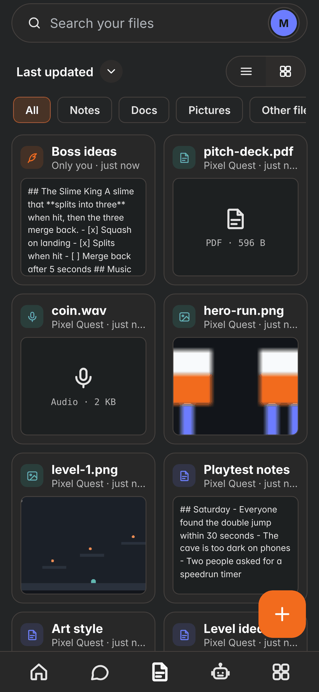
  
  
</p>

### Desktop

A frameless window with real window buttons, project circles, a calm sidebar, breadcrumbs, `Ctrl K` to jump anywhere and a right panel that turns into a preview. Drag the lines between panes to resize them. While your computer hosts the tribe, a green **Hosting** pill at the top left shows who can reach you and has the Host switch; the **?** opens the Guide, keyboard shortcuts, Report a bug and What's new. The top-left flame flickers while something is working. `tribecode://` links open invites in the app, and the profile menu can show the Working version (newest code, live) in its own window.

<table>
  <tr>
    <td width="50%"><br><sub><b>Getting started:</b> room, link, repo and GitHub done; claim roles, drop notes, Start the flow.</sub></td>
    <td width="50%"><br><sub><b>The profile menu:</b> your profile, Connect your Claude Code, your agents, notifications, settings.</sub></td>
  </tr>
</table>

## Connect your AI

Profile menu → **Connect your AI** (or the **TribeCode MCP** page, which lists 15 tools: Claude Code, Codex, Gemini CLI, Qwen Code, Cursor, VS Code, Windsurf, Zed, Cline, Goose, Continue, Claude Desktop, Claude.ai and ChatGPT through your public link, and any MCP client) gives you one command or config. For Claude Code, pick where it runs:

- **Anywhere:** over the tribe's public https link (Tailscale Funnel or cloudflared).
- **Same Wi-Fi:** over the host's network address.
- **This computer:** over localhost.

```bash
claude mcp add --transport http tribecode https://<host>/mcp --header "Authorization: Bearer <your agent key>"
```

Your Claude joins as "Claude · You" with 54 tools: tasks, docs, chat and chat search, file claims, gists, the plan and your role, votes, approvals, preview links, the Workshop, the Secretary, and coordination with other agents (`my_lane`, `handoff`, `request_review`, `delegate`, `agents_post`). Agents never vote, approve or invite. The status shows live, and **Disconnect** revokes the key at once.

**Claude Desktop** connects through the bridge in `scripts/mcp-stdio.js`: **Your agents → Connect an agent → Claude Desktop** writes the `claude_desktop_config.json` entry for Windows or macOS.

## Your data

Everything a tribe makes lives in one folder on the host's computer (`~/TribeCode` by default): chat as JSONL, tasks and docs as Markdown, projects as git repos. Settings → **Download backup** saves it all as a `.tar.gz`. [docs/DATA.md](docs/DATA.md) maps every file and explains backup, restore and moving to a new computer.

## Security & privacy

- **Where data lives:** one folder on the host's computer. There is no TribeCode server; nothing is uploaded unless you push to GitHub or turn on a service below.
- **The public link:** with sharing on, chat, files and docs travel over https between friends and the host. Tailscale Funnel ends that connection on the host; a Cloudflare quick tunnel ends it at Cloudflare. Anyone with an invite can join, so share invites only with people you trust.
- **AI:** each person's agent sends what it reads (chat, docs, tasks) to its own provider. If the host sets a cloud AI key, Flint and `@ai` send their prompts there. Ollama and the in-browser model stay on the device. AI keys and GitHub tokens never leave the host.
- **Agents:** they act for their owner, never above builder. They chat, write docs and tasks and propose; they can't vote, approve, invite, publish, run programs on the host or merge without a person's OK. An agent with shell access on a computer can still do what that computer's user can, so keep its permissions tight.
- **Host-only actions** (programs, installs, local folders, sign-in setup) work only on the host computer, never through the tunnel, another site or a project's preview.
- **Other services, only when used:** link previews (the host visits the site), GIF search (GIPHY), the Workshop shelf and the in-browser model (jsDelivr), ntfy (off until you set it up), Web Push (encrypted, via your browser maker), captions (your browser's speech service).
- Read [SECURITY.md](SECURITY.md) for the full list of what is and isn't protected, and to report a problem privately. `app/test/security_test.py` and `security2_test.py` guard past fixes.

## Roadmap

From [docs/FEATURES-NEXT.md](docs/FEATURES-NEXT.md):

1. Approvals from the lock screen and a morning digest push
2. Play button and playtest sessions: the Game Studio MVP ([docs/GAME-STUDIO.md](docs/GAME-STUDIO.md))
3. Recipes: save a finished feature from a gist and replay it before spending tokens
4. Scheduled backups and restore inside the app
5. "Catch me up" per project
6. Offline send queue on phones, threads, a health page for the host, an agent budget meter, GitHub link unfurls

Later: native iOS through Tauri and TestFlight, shared compute between friends, a tool scout, a level editor.

## Develop and test

```bash
npm start                         # server on :4747, tribe folder ~/TribeCode (--port, --dir, --name, --ollama)
npm run live                      # auto-pull + restart + UI live reload
npm run invite                    # one-click public invite + QR
node scripts/start-test-project.js   # Pixel Quest test project + invite + Claude Code command
npm test                          # the full suite (Python Playwright + Chrome)
npm run dev:shots                 # regenerate every README, website and docs screenshot (docs/DEV-TOOLS.md)
npm run explore                   # the Explorer: clicks through the whole app, writes docs/EXPLORE-REPORT.md
npm run milestone-report          # before/after screenshots and findings against the last release
cd app && npm install && npm run dev   # the desktop app (Tauri v2, needs Rust)
```

The server and web app are plain Node and browser JavaScript with zero npm dependencies; the desktop app is a Tauri v2 wrapper with the server as a sidecar. A release is published when the version in `app/src-tauri/tauri.conf.json` changes on `main`: installers for all three platforms plus the signed `latest.json` the in-app updater reads. If the app can't start it clears stale caches and reloads once, then offers to send a report (self-heal). [HANDOFF.md](HANDOFF.md) has the map of the code and the release steps, [docs/DESIGN-SYSTEM.md](docs/DESIGN-SYSTEM.md) the design rules, and [CHANGELOG.md](CHANGELOG.md) what changed.

## License

[MIT](LICENSE) © 2026 orionopenwow and TribeCode contributors. Not affiliated with Anthropic.
