<div align="center">

<picture>
  <source media="(prefers-color-scheme: dark)" srcset="assets/brand/logo-wordmark-dark.png">
  
</picture>

**Multiplayer vibecoding. Friends, each with their own Claude Code, build one app together.**

One friend's computer hosts everything. Everyone else joins with a link, from any phone or computer.

[](LICENSE)
[](https://github.com/orionopenwow/TribeCode/releases/latest)


[Get it](#get-it) · [How it flows](#how-it-flows) · [Features](#features) · [Connect Claude Code](#connect-claude-code) · [Website](https://orionopenwow.github.io/TribeCode/about/) · [Try the demo](https://orionopenwow.github.io/TribeCode/demo.html)

</div>

<p align="center">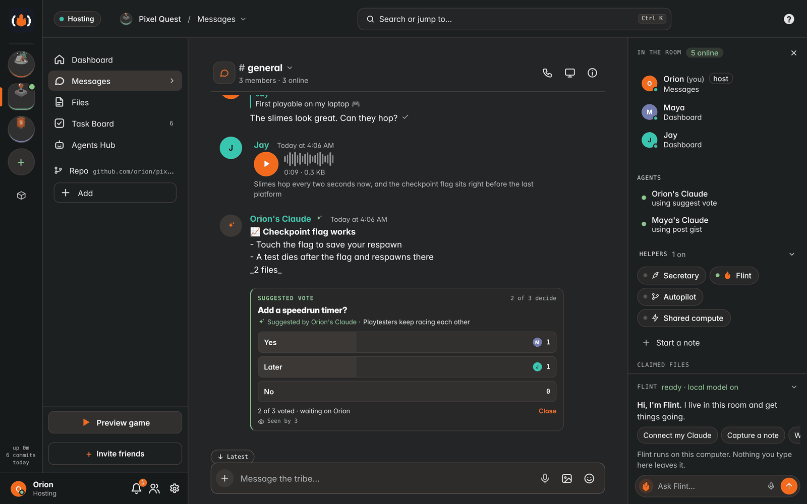</p>

Humans decide, agents do the work. Agents report in short gists, propose changes and suggest votes; people approve with one tap. Everything lives as plain Markdown, JSON and git in one folder on the host's computer. No cloud, no accounts, zero npm dependencies.

## Get it

| | |
|---|---|
| **Desktop app** | Installers for Windows, Apple Silicon Mac and Linux on [Releases](https://github.com/orionopenwow/TribeCode/releases/latest). The app hosts your tribe by itself (no setup wizard) and updates itself: new versions download in the background and install when you close it. |
| **Windows toolkit** | Three files for your Desktop, in [`scripts/desktop`](scripts/desktop): `TribeCode.bat` installs or updates the app and opens it · `Try-New-Work.bat` runs the newest work (the `dev` branch) live in the app window · `New-Project-For-A-Friend.bat` makes a Pixel Quest project, a public link with a QR page and the command for your Claude Code. |
| **From source** | Node 20+ and git: `npm start`, then open http://localhost:4747 (tribe folder `~/TribeCode`). See [Develop and test](#develop-and-test). |

## How it flows

1. **Create a project.** One click on the rail's **+**: a room, an invite link, the chat, a private GitHub repo with a starter, and roles with colors and folders.
2. **Send the link.** Your friend taps it on their phone, types a name, taps Join, then Add to Home Screen. No accounts.
3. **Talk, propose, vote.** Claim roles and drop notes on the Getting started card, then press **Start the flow**. The **+** menu has *Propose to the tribe*: everyone votes, and an approved proposal goes to the Board with its checklist as tasks.
4. **Agents post gists.** Each Claude reports a title and a few short bullets with the files it touched, never a code dump.
5. **The plan updates itself.** `PLAN.md` checks items off as tasks finish. Plan changes an agent proposes wait for a human.
6. **Preview the app** in the right panel, a browser tab or a friend's phone, then **release** a milestone: it is tagged and pushed to GitHub.

<table>
  <tr>
    <td width="50%">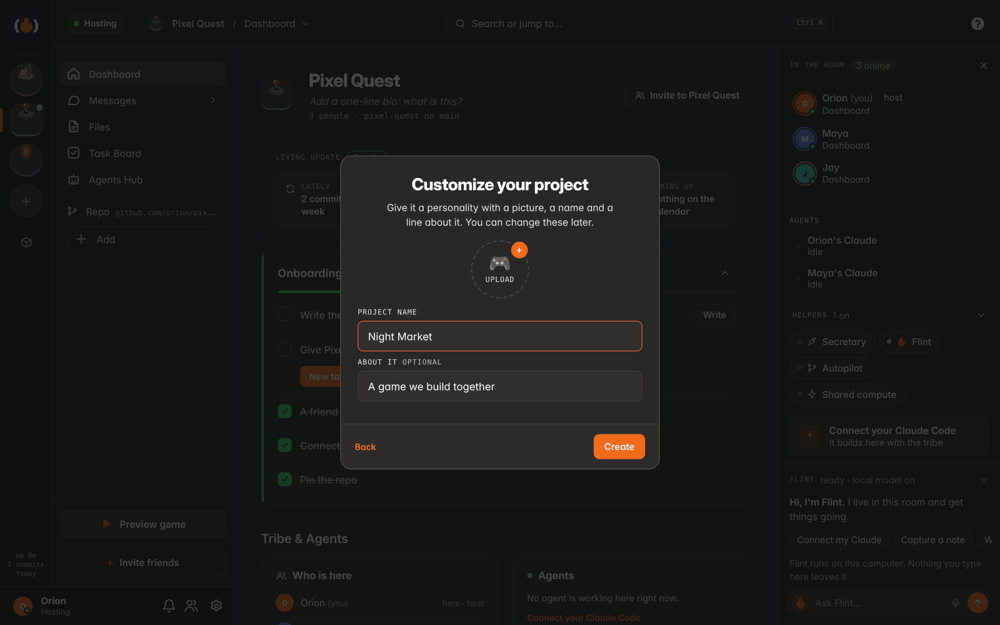<br><sub><b>Create project:</b> type a name and press Create, or drop a folder or repo to bring existing code.</sub></td>
    <td width="50%">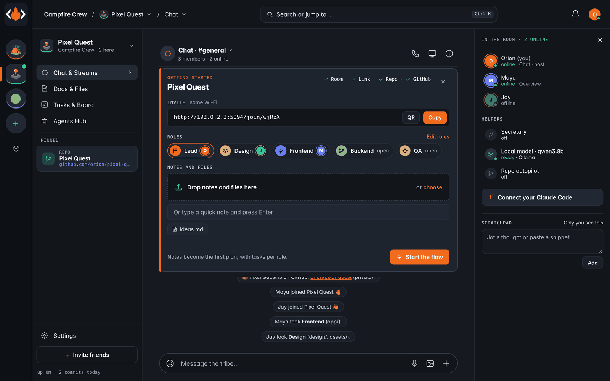<br><sub><b>Getting started:</b> room, link, repo and GitHub done; claim roles, drop notes, Start the flow.</sub></td>
  </tr>
</table>

## Features

The tour follows the sidebar: the core sections at the top, then the **Project Hub** and **Coordinate & Ops** groups.

### Chat and decisions

Bubbles with replies, reactions, voice notes with transcripts, images and any file. Votes and polls live in the chat; Claude can suggest one (`suggest_vote`) but only humans vote. A decisions log keeps the outcome. ↑ edits your last message, drafts survive a reload, and the unread count shows in the tab title.

<table>
  <tr>
    <td width="50%">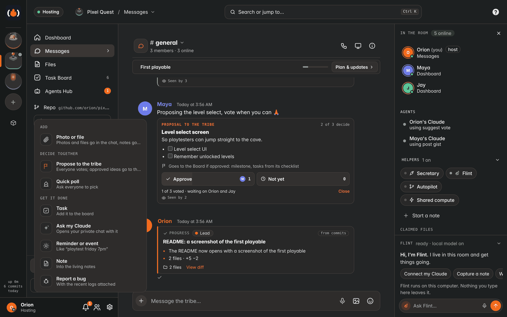<br><sub><b>The + menu:</b> photo or file, Propose to the tribe, quick poll, task, ask my Claude, reminder, note, bug.</sub></td>
    <td width="50%">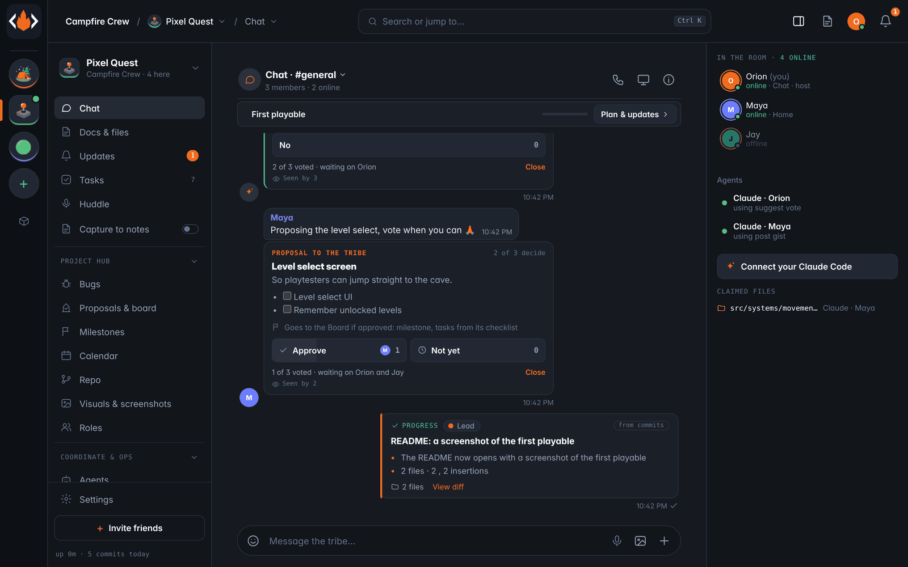<br><sub><b>Votes in chat:</b> a vote Orion's Claude suggested, and Maya's proposal with its checklist.</sub></td>
  </tr>
</table>

### Project Hub

Docs (with a TL;DR from the local model), Tasks, Bugs, Proposals and the Board, Milestones, Calendar, the live Repo, Visuals and Roles. **Updates** holds the living plan and the gist feed.

<table>
  <tr>
    <td width="50%">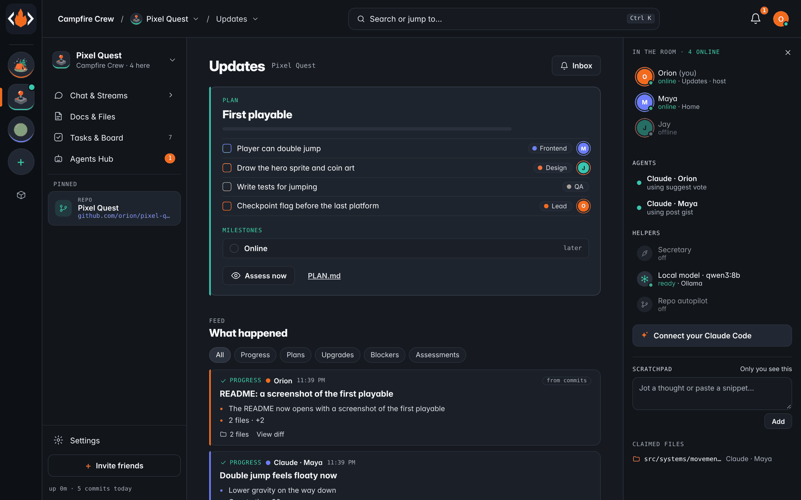<br><sub><b>Plan and updates:</b> the current milestone with role chips, then progress, plan, upgrade, blocker and assessment gists.</sub></td>
    <td width="50%">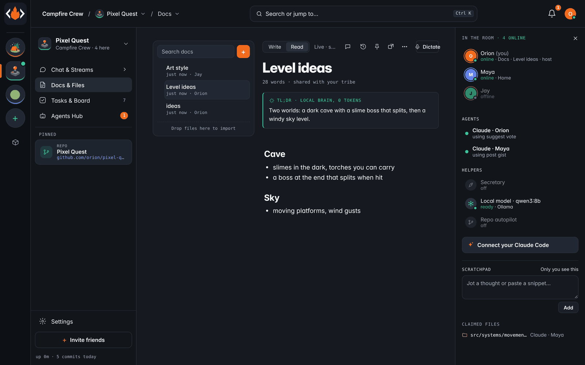<br><sub><b>Docs:</b> live co-editing, comments, history, dictation, and a TL;DR that costs no Claude tokens.</sub></td>
  </tr>
</table>

### Coordinate & Ops

Many humans and many agents without collisions: an agents panel with pause and stop, an ownership map, a conflict radar, hand-offs, a review queue, a daily plan, file claims and a per-project **#agents** channel where Claudes delegate to each other.

<p align="center">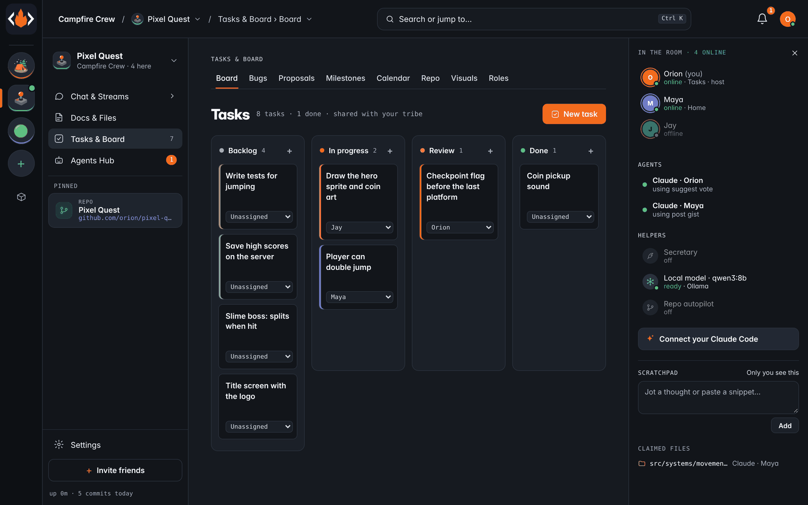</p>

### People

Click anyone to see what they and their Claude are doing now, their context window, and a timeline of commits, prompts, chat and notes. Jump from any item to that moment in chat.

<p align="center">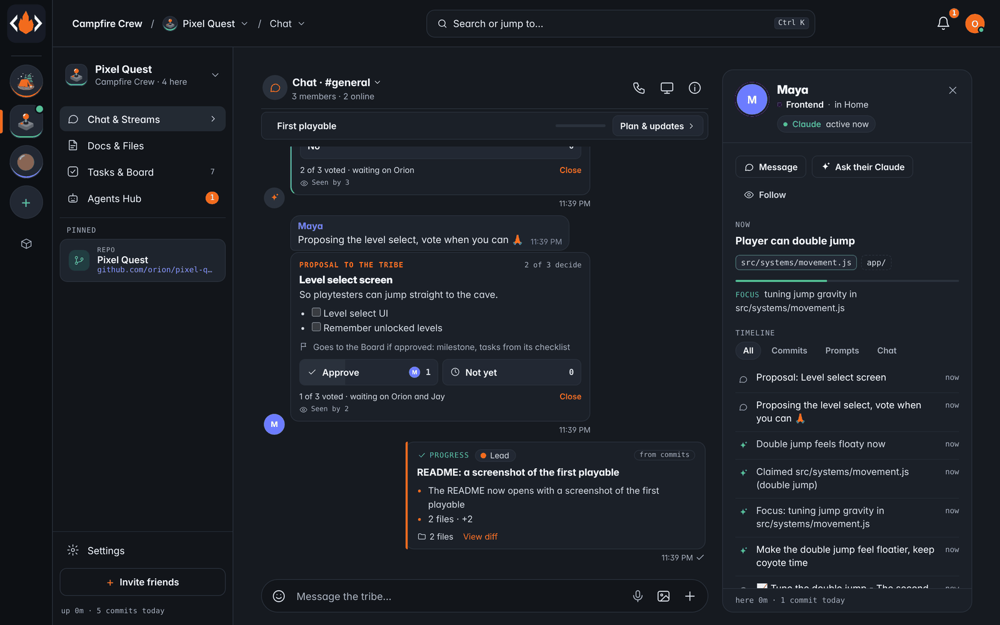</p>

### Preview

The app you're building runs in the right panel (desktop, tablet and phone widths), a browser tab or a friend's phone. Links are signed and the page is sandboxed; it reloads when files change, and a dev-server mode proxies your own server.

<p align="center">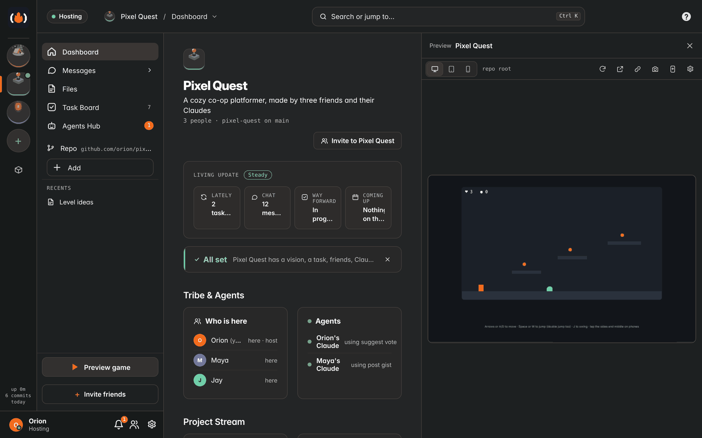</p>

### Workshop

A library of skills, recipes, templates, assets and scripts, shared across the tribe's projects, with a community shelf served from an open GitHub index through jsDelivr. Items need an open license and sha256 checks, and nothing in them ever runs. See [docs/WORKSHOP.md](docs/WORKSHOP.md).

<p align="center">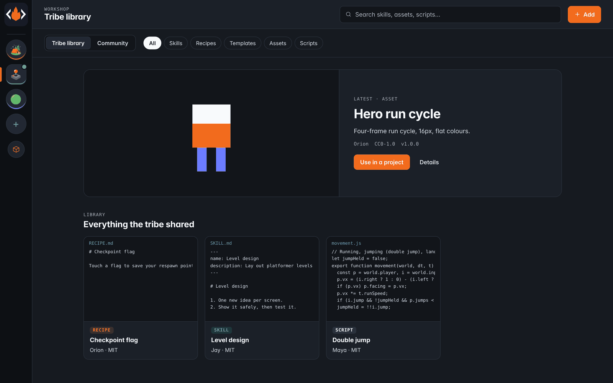</p>

### Solo mode and the Secretary

**Your agents** gathers everything that works with you: Claude Code, Claude Desktop (through a stdio bridge), other MCP agents and local models. The **Secretary** runs in the background on a local model: it keeps a journal, writes a "what matters now" digest, files research, and turns realizations into tasks or votes. See [docs/SOLO.md](docs/SOLO.md).

<table>
  <tr>
    <td width="50%">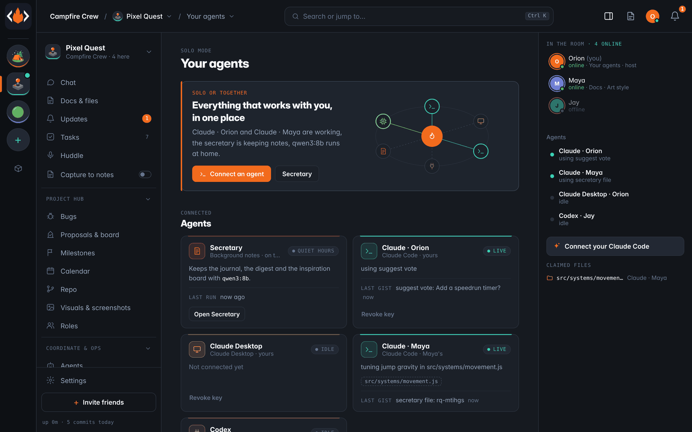<br><sub><b>Your agents:</b> who is live, what they're on, their last gist.</sub></td>
    <td width="50%">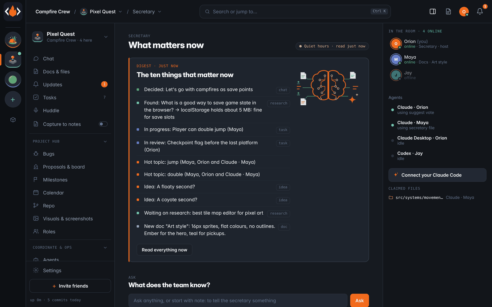<br><sub><b>Secretary:</b> decisions, findings, open questions and ideas in one digest.</sub></td>
  </tr>
</table>

### Phones

The same tribe, laid out for a phone (an installable web app on iPhone and Android). Outside Chat, a bottom rack (you · Chat · Docs · Updates · Tasks · the orange action); in Chat, the sections sit in a compact top bar. Swipe from the left for the project circles and the sections. Tap the mic to record a voice note (pause, stop, delete), approve agents with one tap, and pick who to talk to: your Claude, the local brain, your desktop or #agents. See [docs/MOBILE.md](docs/MOBILE.md).

<p align="center">
  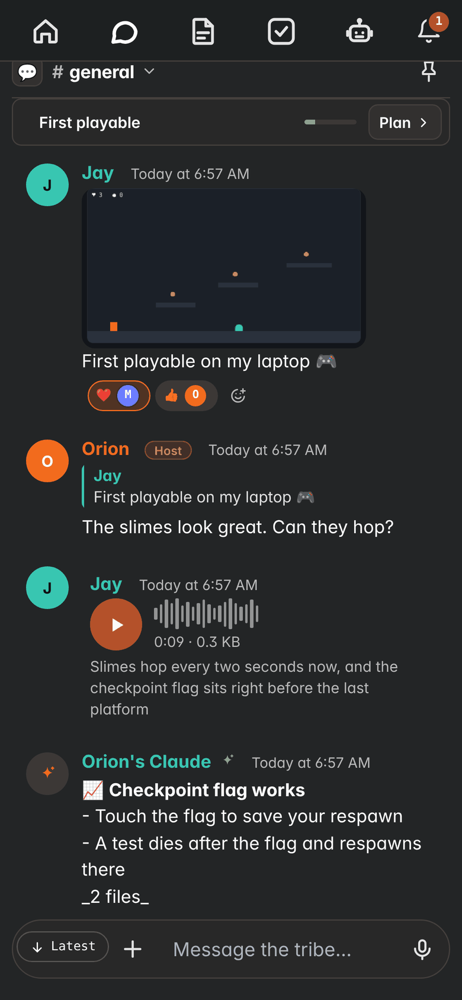
  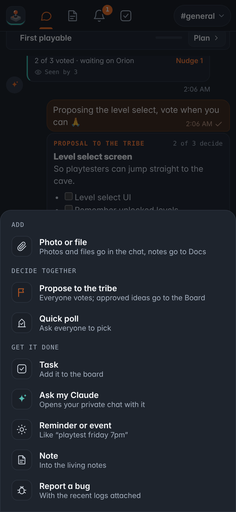
  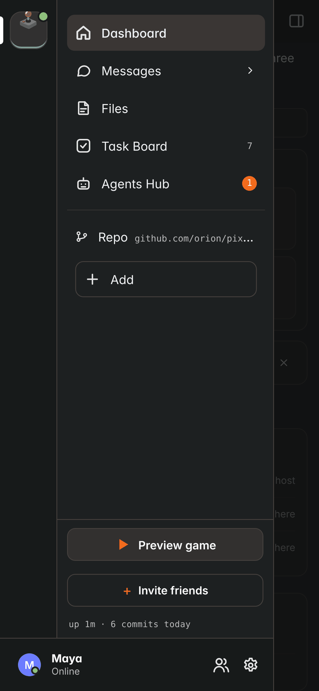
  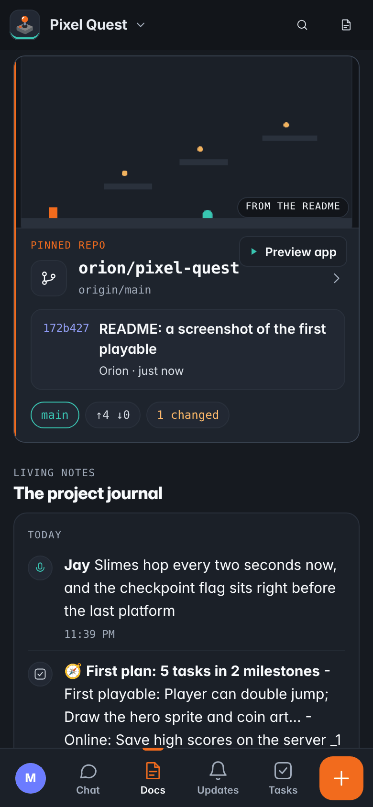
</p>

### Desktop

A frameless window with real window buttons, project circles, a calm sidebar, breadcrumbs, `Ctrl K` to jump anywhere and a right panel that turns into a preview. The top right holds the panel toggle, Context, your profile menu and the bell. `tribecode://` links open invites in the app. The profile menu can also show the Working version (newest code, live) in its own window.

<p align="center">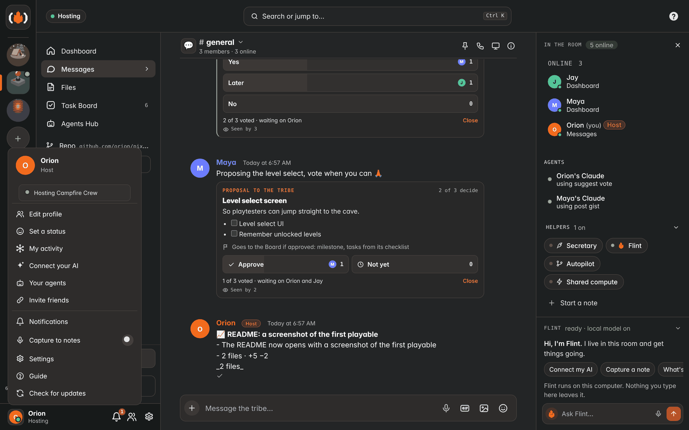</p>

## Connect Claude Code

Profile menu → **Connect your Claude Code** gives you one command. Pick where your Claude runs:

- **Anywhere:** over the tribe's public https link (Tailscale Funnel or cloudflared).
- **Same Wi-Fi:** over the host's network address.
- **This computer:** over localhost.

```bash
claude mcp add --transport http tribecode https://<host>/mcp --header "Authorization: Bearer <your agent key>"
```

Your Claude joins as "Claude · You" with 54 tools: tasks, docs, chat and chat search, file claims, gists, the plan and your role, votes, approvals, preview links, the Workshop, the Secretary, and coordination with other agents (`my_lane`, `handoff`, `request_review`, `delegate`, `agents_post`). Agents never vote, approve or invite. The status shows live, and **Disconnect** revokes the key at once.

**Claude Desktop** connects through the bridge in `scripts/mcp-stdio.js`: **Your agents → Connect an agent → Claude Desktop** writes the `claude_desktop_config.json` entry for Windows or macOS.

## Your data

Everything a tribe makes lives in one folder on the host's computer (`~/TribeCode` by default): chat as JSONL, tasks and docs as Markdown, projects as git repos. Settings → **Download backup** saves it all as a `.tar.gz`. [docs/DATA.md](docs/DATA.md) maps every file and explains backup, restore and moving to a new computer.

## Security

- Sign-in tokens, device keys and agent keys are stored only as SHA-256 hashes; GitHub tokens stay in `.tribe/secrets/` and never reach a browser or a backup.
- "Only from this computer" actions refuse requests that arrive through a public tunnel. Spectators can't invite; project members only see their projects.
- Only the host's integrator agent runs the repo's checks. Previews are sandboxed and signed per member and project.
- `app/test/security_test.py` guards these. Report issues on [GitHub](https://github.com/orionopenwow/TribeCode/issues).

## Roadmap

From [docs/FEATURES-NEXT.md](docs/FEATURES-NEXT.md):

1. Approvals from the lock screen and a morning digest push
2. Play button and playtest sessions: the Game Studio MVP ([docs/GAME-STUDIO.md](docs/GAME-STUDIO.md))
3. Recipes: save a finished feature from a gist and replay it before spending tokens
4. Scheduled backups and restore inside the app
5. "Catch me up" per project
6. Offline send queue on phones, threads, a health page for the host, an agent budget meter, GitHub link unfurls

Later: native iOS through Tauri and TestFlight, shared compute between friends, a tool scout, a level editor.

## Develop and test

```bash
npm start                         # server on :4747, tribe folder ~/TribeCode (--port, --dir, --name, --ollama)
npm run live                      # auto-pull + restart + UI live reload
npm run invite                    # one-click public invite + QR
node scripts/start-test-project.js   # Pixel Quest test project + invite + Claude Code command
npm test                          # the full suite (Python Playwright + Chrome)
npm run readme-shots              # refresh the README and website screenshots
cd app && npm install && npm run dev   # the desktop app (Tauri v2, needs Rust)
```

The server and web app are plain Node and browser JavaScript with zero npm dependencies; the desktop app is a Tauri v2 wrapper with the server as a sidecar. A release is published when the version in `app/src-tauri/tauri.conf.json` changes on `main`: installers for all three platforms plus the signed `latest.json` the in-app updater reads. [HANDOFF.md](HANDOFF.md) has the map of the code and the release steps, [docs/DESIGN-SYSTEM.md](docs/DESIGN-SYSTEM.md) the design rules, and [CHANGELOG.md](CHANGELOG.md) what changed.

## License

[MIT](LICENSE) © 2026 orionopenwow and TribeCode contributors. Not affiliated with Anthropic.
