<div align="center">

<picture>
  <source media="(prefers-color-scheme: dark)" srcset="assets/brand/logo-wordmark-dark.png">
  
</picture>

### Code with friends. One link to join, one shared brain, one vision.

TribeCode is a lightweight, self-hosted clubhouse for building software together with your friends **and** your Claude Code agents: chat, docs, tasks, proposals and live sessions in one glassy desktop app.

[](LICENSE)


[Features](#-features) · [Screenshots](#-screenshots) · [How it works](#-how-it-works) · [Roadmap](#-roadmap) · [Feature spec](docs/FEATURE_SPEC.md) · [Brand](docs/BRAND.md)

</div>

---

> **Status:** early build. Working today: desktop shell, first-run setup, tour, auto-updater, the tribe server (invite links, presence, chat with `/task` and `/decide`), a shared drag-and-drop Tasks board, the approval board (proposals, votes, VISION.md, milestones tagged in git), shared Docs with a Notion-style editor, and the local brain (doc TL;DRs, daily standups, vision checks on proposals). Also working: the drift radar, a self-sorting, self-healing bug inbox, and the `Ctrl+K` command palette. The desktop app hosts the tribe itself and handles `tribecode://` invite links (built by CI, not yet run on real hardware) from [`design/mockups/app.html`](design/mockups/app.html) and are coming next (see [Roadmap](#-roadmap)).

<p align="center">
  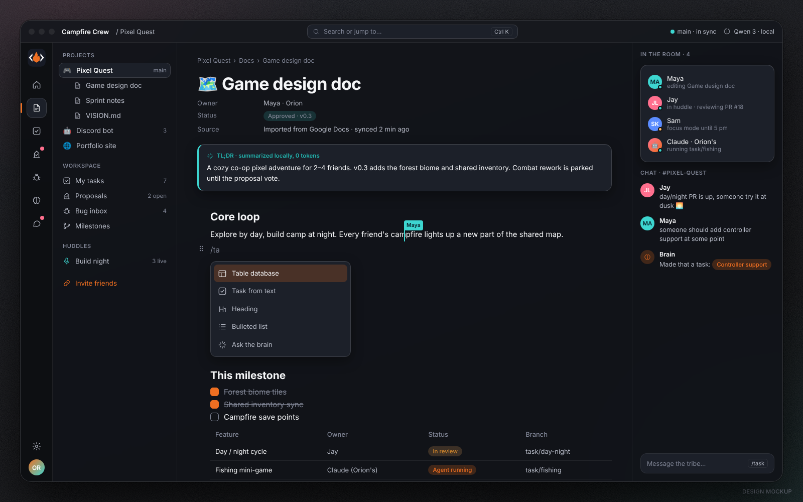
</p>

## ✨ Why TribeCode

Multiplayer Claude Code tools already let people share a terminal session. TribeCode is built for the part that comes next: keeping a small crew **aligned** while everyone (and every agent) builds at once.

- **🔗 One link to join.** Send `tribe.link/k7Qx2`. Your friend picks a name and a color and is in. No email, no password form.
- **🧭 One vision.** Proposals, an approval board, a drift radar and a `VISION.md` check stop people from building divergent copies.
- **🧠 A zero-token brain.** A local Qwen model (via Ollama) writes summaries, standups and triage and keeps project memory, so Claude tokens go to real code.
- **📝 Notion-like docs next to the code.** Blocks, slash menu, inline databases and Google Docs import, all stored as Markdown in your repo.
- **🏷️ Milestones ship themselves.** When the board approves a milestone, TribeCode tags it, writes the changelog and pushes it to GitHub.

## 🧩 Features

| Area | Highlights |
| --- | --- |
| **Sessions** | Live lobby + follow mode · shared Claude Code relay over MCP · soft file claims · one-click voice huddles · spectator links |
| **Alignment** | Proposals + approval board · drift radar · vision check · milestone auto-commit to GitHub · session snapshots · merge helper |
| **Tasks** | Chat-to-task · auto standup · task ↔ branch link · assign tasks to Claude agents with a token cap · token budget meter |
| **Knowledge** | Universal drop zone (any file → Markdown + TL;DR) · local semantic search · decision log · brain review queue · onboarding pack |
| **Quality of life** | `Ctrl+K` command palette · focus mode + digest · one-key bug capture · shared skill shelf · easy remote hosting via Tailscale |
| **Core** | Docs · Tasks · Projects · self-sorting, self-healing bug reports · drag and drop everywhere · glassmorphic dark + light themes |

The full list of 25 features with rationale is in **[docs/FEATURE_SPEC.md](docs/FEATURE_SPEC.md)**.

## 📸 Screenshots

<table>
  <tr>
    <td width="50%">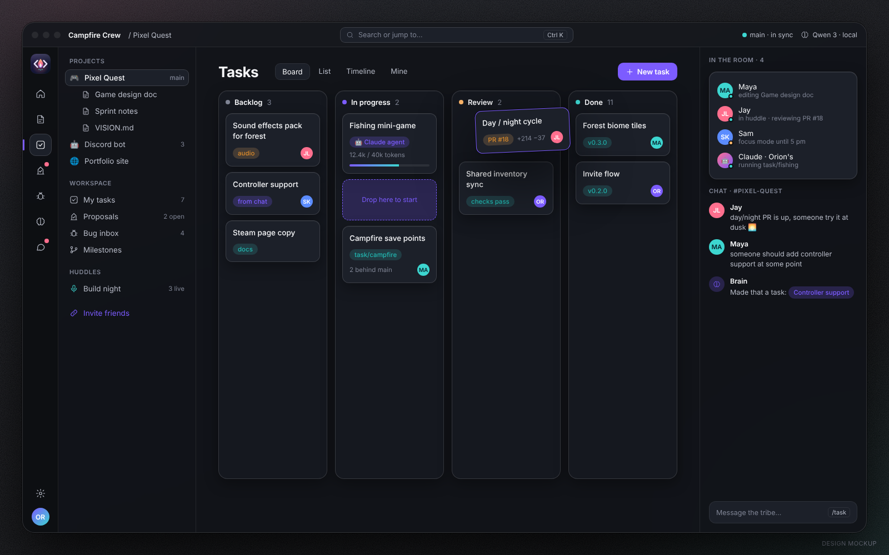<br><sub><b>Tasks:</b> drag cards between columns, start a branch by dropping, watch an agent's token budget.</sub></td>
    <td width="50%">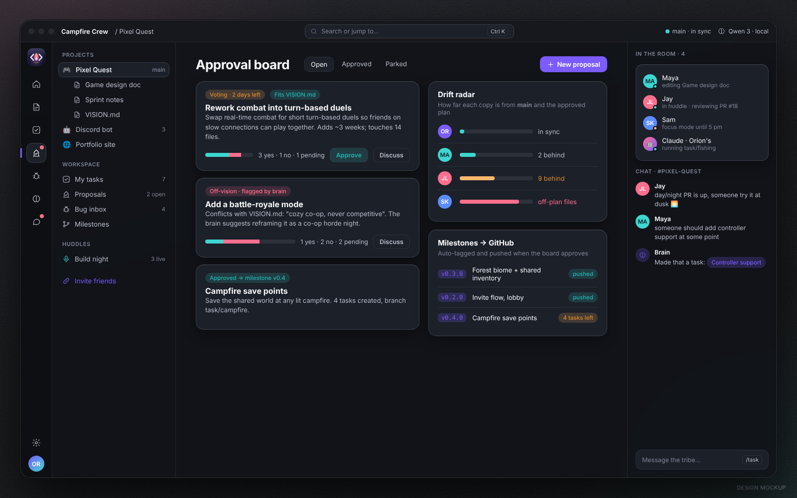<br><sub><b>Approval board:</b> vote on proposals, see who is drifting from main, track milestones pushed to GitHub.</sub></td>
  </tr>
  <tr>
    <td width="50%">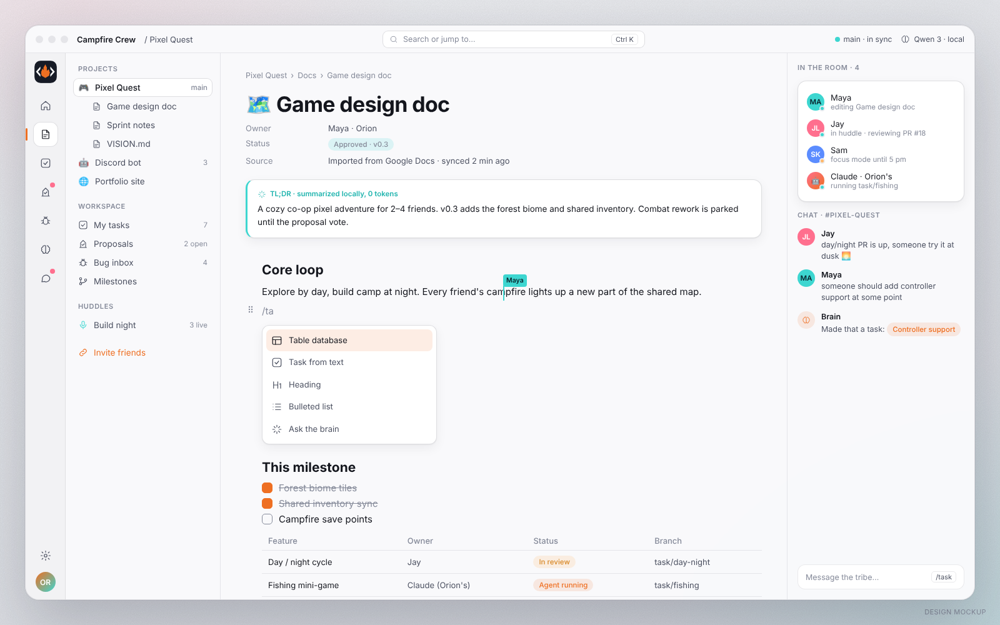<br><sub><b>Light mode:</b> the same glass, brighter. Notion-style blocks with a local TL;DR.</sub></td>
    <td width="50%">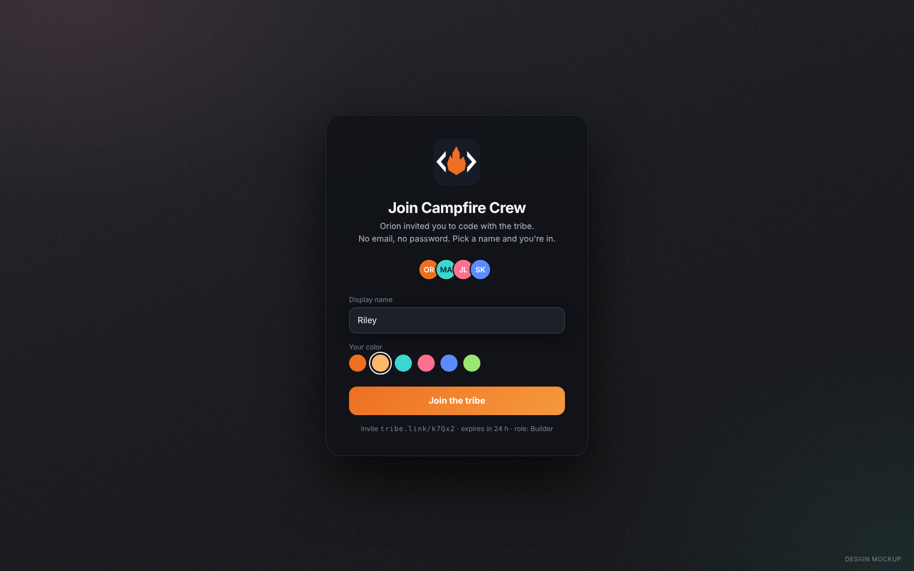<br><sub><b>Joining:</b> one link, a name and a color. That's the whole sign-up.</sub></td>
  </tr>
</table>

### First launch and updates (working today)

<table>
  <tr>
    <td width="50%">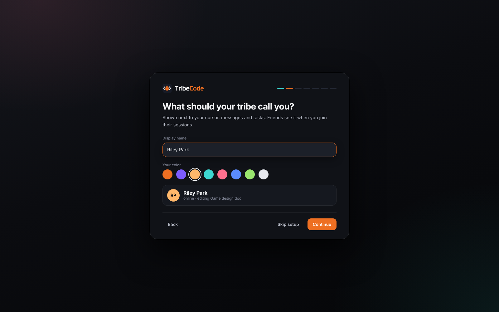<br><sub><b>First-run setup:</b> name, color, theme, folder, local brain and startup preferences. No account needed; everything stays on your machine.</sub></td>
    <td width="50%">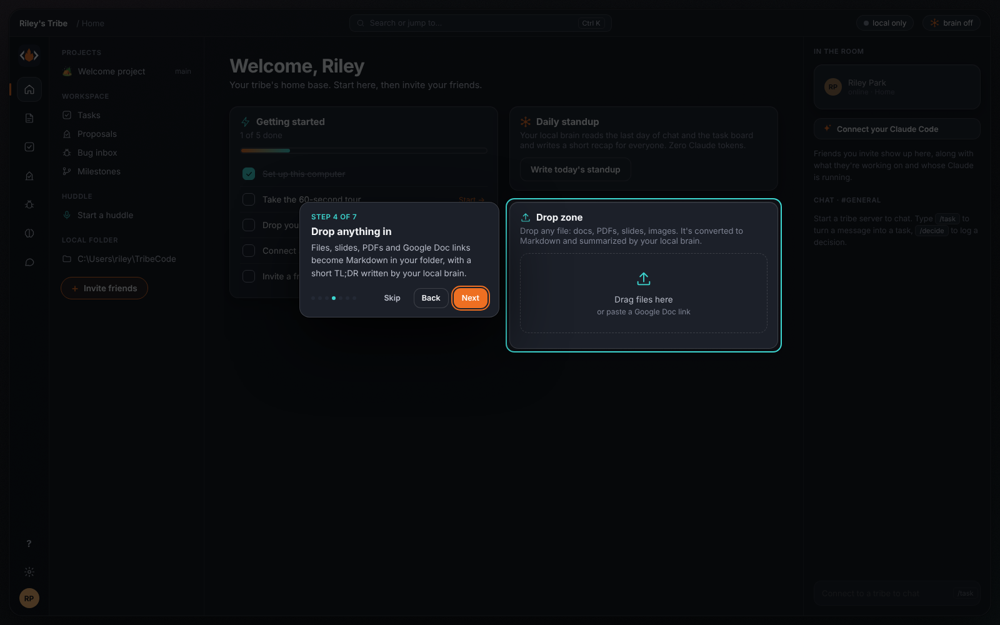<br><sub><b>60-second tour:</b> a spotlight walkthrough of the app. Replay it any time with the <b>?</b> button.</sub></td>
  </tr>
  <tr>
    <td width="50%">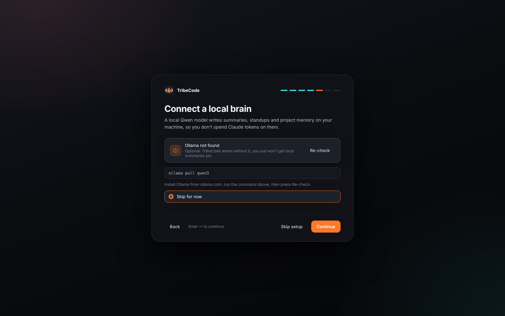<br><sub><b>Local brain:</b> detects Ollama and your Qwen models automatically, or shows the one command to install it.</sub></td>
    <td width="50%">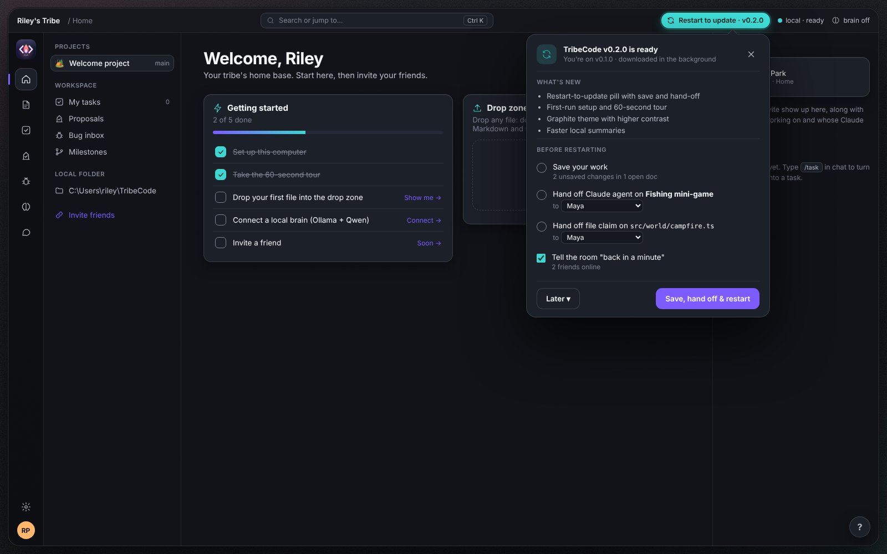<br><sub><b>Restart to update:</b> new versions download in the background. When it suits you, save your work, hand off running agents and claims, and restart, or snooze it.</sub></td>
  </tr>
</table>

### Voice huddles

<p align="center">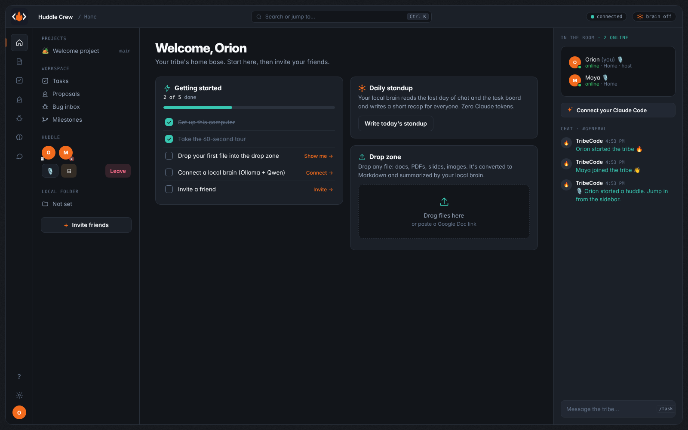</p>

Click **Start a huddle** in the sidebar (or <kbd>Ctrl Shift M</kbd>). Audio goes peer to peer over WebRTC, with screen sharing and speaking indicators. No extra server, and it's built for groups of up to about 6. Browsers only allow the microphone on `localhost`, `https://` or the desktop app.

### Bring your Claude Code

Click **Connect your Claude Code** in the room panel and run the one-line command it gives you:

```bash
claude mcp add --transport http tribecode http://HOST:4747/mcp --header "Authorization: Bearer <your agent key>"
```

Your Claude Code joins the tribe as an agent ("Claude · Riley"). It shows up in the room while it works and gets 14 tools: `tribe_overview`, `list_tasks`, `create_task`, `update_task`, `list_docs`, `read_doc`, `write_doc` (with version checks, so it never overwrites a teammate), `post_chat`, `read_chat`, `claim_file`, `release_file`, `list_claims`, `read_vision`, `propose`. Agents respect file claims and VISION.md, but they can't vote or invite people. That stays with the humans.

<p align="center">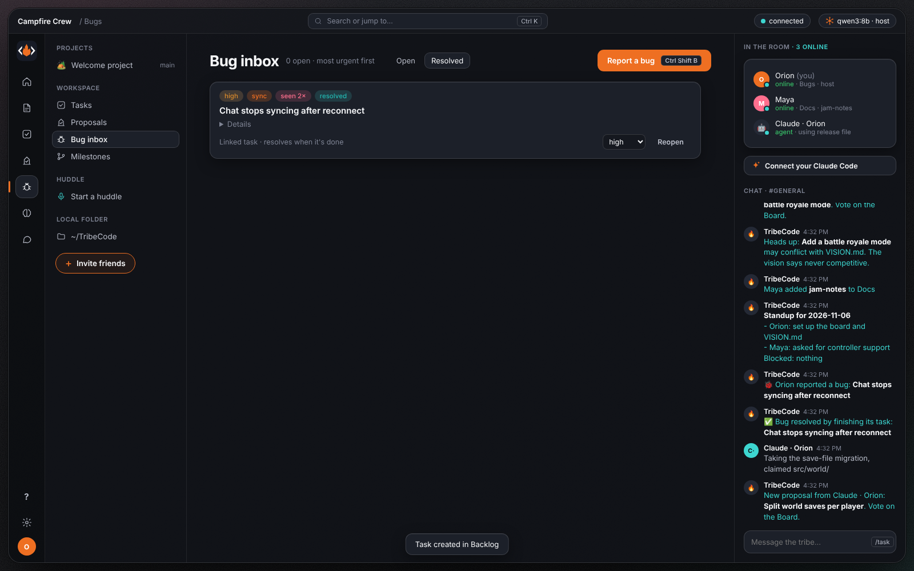</p>

### Live tribe (working today)

<table>
  <tr>
    <td width="50%">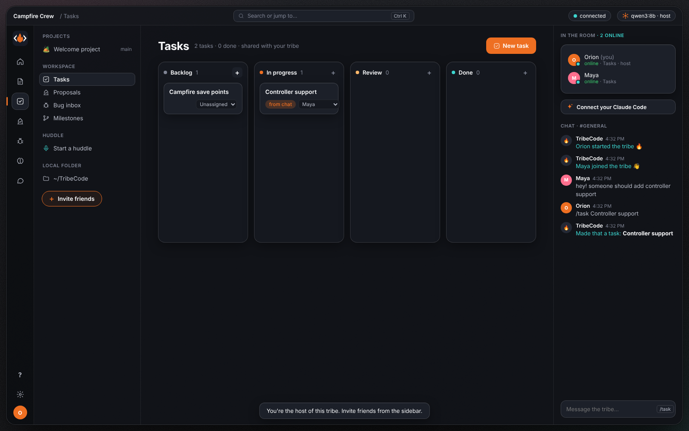<br><sub><b>Tasks + chat + presence:</b> drag cards between columns and every friend sees it instantly. <code>/task</code> in chat makes a card.</sub></td>
    <td width="50%">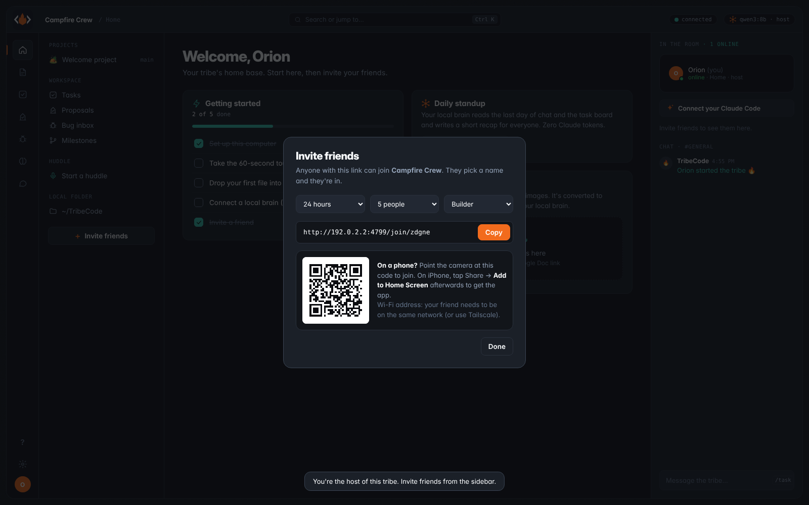<br><sub><b>Invite links:</b> pick how long it lasts, how many people, and builder or spectator. Copy, send, done.</sub></td>
  </tr>
  <tr>
    <td colspan="2">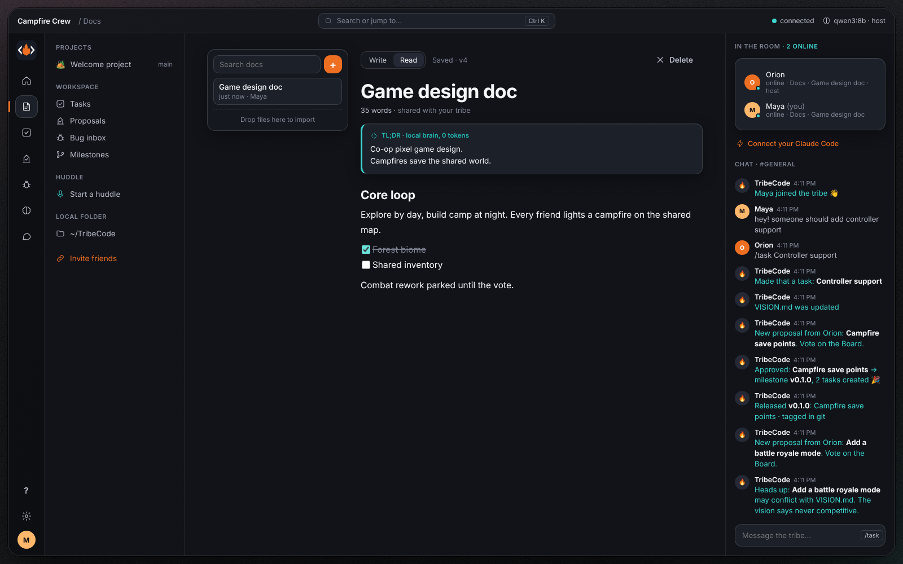<br><sub><b>Docs:</b> Markdown pages with a <code>/</code> block menu, autosave, live updates, conflict handling, file import, and a TL;DR written by the host's local Qwen model.</sub></td>
  </tr>
  <tr>
    <td width="50%">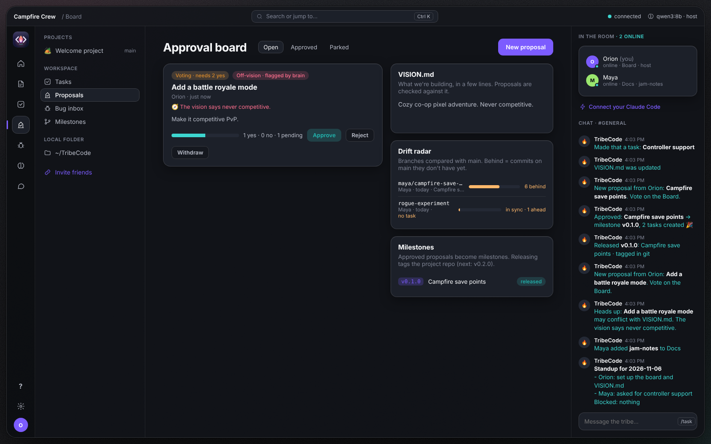<br><sub><b>Drift radar + vision check:</b> every branch compared with main, flagged when it falls behind or isn't tied to a task. The local brain flags proposals that conflict with VISION.md.</sub></td>
    <td width="50%">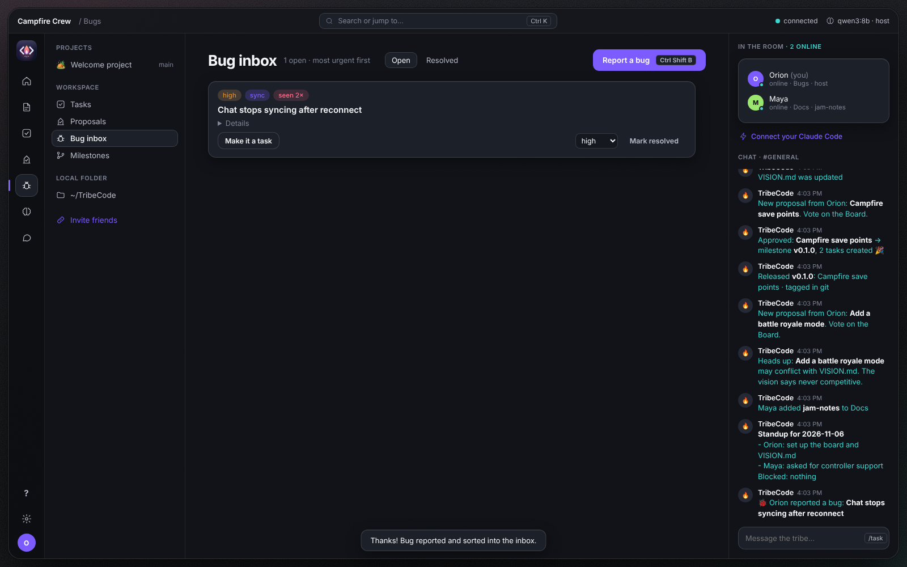<br><sub><b>Bug inbox:</b> <kbd>Ctrl Shift B</kbd> from anywhere. Reports are triaged automatically, duplicates merge, crashes report themselves, and a bug resolves itself when its task is done.</sub></td>
  </tr>
  <tr>
    <td colspan="2">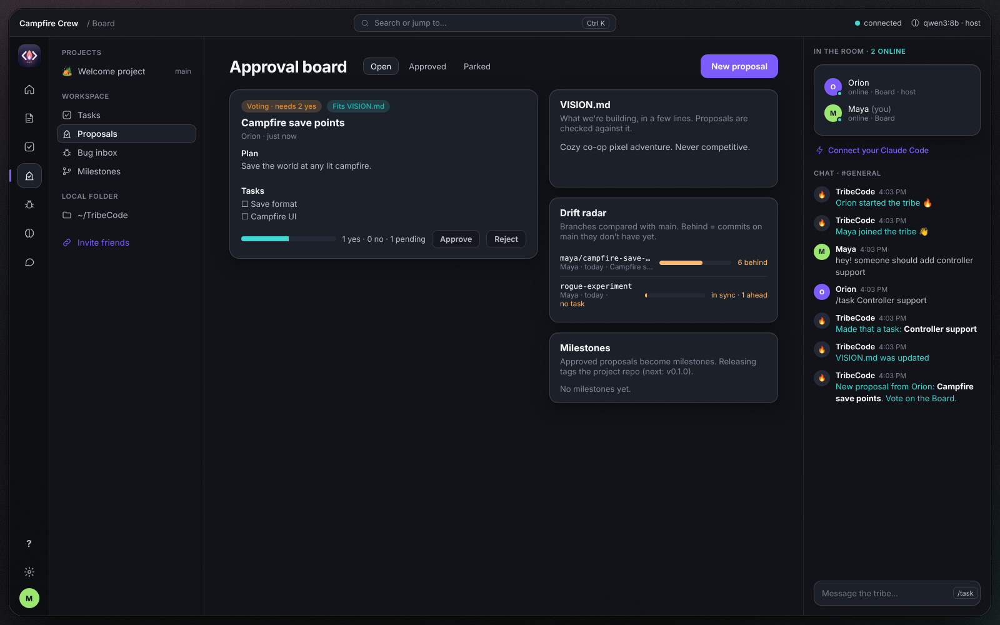<br><sub><b>Approval board:</b> propose a change, the tribe votes (majority wins). Approval creates a milestone, turns the checklist into tasks and logs a decision. The host releases a milestone and it's tagged in your project repo and pushed to GitHub.</sub></td>
  </tr>
</table>

## 🚀 Run it

**Fastest (Windows):** download [`TribeCode-Live-Test.bat`](TribeCode-Live-Test.bat), double-click it. It installs nothing but checks for Node and Git, gets the code, starts a tribe and opens it in your browser. It also pulls new commits every 20 seconds and reloads, so you can watch the app change as it's built. macOS/Linux: `tribecode-live-test.command`.

```bash
# Host a tribe (Node 20+, zero dependencies)
npm start                         # or: node server/index.js --port 4747 --dir ~/TribeCode --name "Campfire Crew" --repo ~/code/my-game --ollama http://localhost:11434
# open http://localhost:4747, finish setup (you become the host), click "Invite friends"

# Try the UI in a browser (no install needed)
open app/ui/index.html            # ?reset=1 replays first-run setup, ?demo=1 adds demo teammates,
                                  # ?simulateUpdate=0.2.0 shows the update pill

# Desktop app (needs Node 22 + Rust: https://tauri.app/start/prerequisites/)
cd app && npm install
npm run dev                       # builds the server sidecar, opens a live desktop window
npm run build                     # Windows .exe/.msi, macOS .dmg, Linux AppImage in app/src-tauri/target/release/bundle/
```

**Hosting from the desktop app:** click **Invite friends → Host a tribe on this computer**. The app starts the bundled tribe server (a standalone binary built from `server/` with Node SEA, so nobody needs Node installed), makes you the host, and keeps hosting whenever the app is open. Friends who click an invite link can join in the browser or hit **Open it there** to join inside their desktop app (`tribecode://` links).

**First release (one command):** `node scripts/setup-release.js`. It needs git and the [GitHub CLI](https://cli.github.com) (`gh auth login`). It creates the update-signing key, saves it to the repo's secrets, and tags `v0.1.0`; GitHub Actions then builds the Windows, macOS and Linux installers into a Release.

**Shipping updates:** `./scripts/milestone.sh v0.2.0 "What changed"` bumps the app version, tags and pushes. [`.github/workflows/release.yml`](.github/workflows/release.yml) builds installers for all three platforms and publishes a GitHub Release with `latest.json`, and every running copy shows **Restart to update** within 30 minutes.

## ⚙️ How it works

```
 Each member's desktop                 Tribe server (any member can host)        Outside
┌──────────────────────┐   sync    ┌────────────────────────────────┐
│ Tauri app (glass UI) │ ◀───────▶ │ Relay + presence (WebSocket)   │ ──▶ GitHub (milestone tags)
│ Claude Code ── MCP ──┤           │ Yjs live doc sync              │ ◀─▶ Google Drive
│ Ollama + Qwen brain  │           │ Git worktree (Markdown = truth)│ ◀── Tailscale / tunnel
└──────────────────────┘           │ Governance: proposals, drift   │
                                   └────────────────────────────────┘
```

Everything (docs, tasks, proposals, decisions, the brain's memory) is plain Markdown and JSON in a git worktree, so people, agents and git all read the same source of truth.

## 🗺️ Roadmap

- [x] **Phase 0: Design.** Feature spec, brand kit, UI mockups, MIT license (`v0.0.1`)
- [x] **Sprint 1: Desktop shell.** First-run setup, 60-second tour, getting-started checklist, auto-update with save and hand-off, Tauri wrapper, release CI (`v0.1.0`)
- [x] **Sprint 2: Tribe server.** Zero-dependency Node server, invite links + join page, presence, chat with `/task` and `/decide`, Markdown/JSONL storage
- [x] **Sprint 3: Tasks.** Shared drag-and-drop board, quick add, inline rename, assign, offline local mode
- [x] **Sprint 4: Approval board.** Proposals + majority voting, VISION.md, approval → milestone + tasks + decision log, host releases tag the project repo
- [x] **Sprint 5: Docs + local brain.** Markdown docs with slash menu, autosave, conflicts, import; Ollama-powered TL;DRs, standups and vision checks
- [x] **Sprint 6: Alignment + QoL.** Drift radar, self-sorting/self-healing bug inbox with crash capture, `Ctrl+K` command palette
- [x] **Sprint 7: Packaging.** Server bundled as a sidecar in the desktop app, one-click hosting, `tribecode://` invite links, single-instance app, in-app join from any link
- [x] **Sprint 8: Claude Code relay.** MCP endpoint (`/mcp`), agents with presence, soft file claims with hand-off, follow a teammate
- [x] **Sprint 9: Voice.** Peer-to-peer huddles with mute, speaking indicators and screen share; live-test launcher; new logo
- [ ] **Next:** live co-editing (Yjs), Google Drive import, PDF/Office conversion
- [ ] **Phase 1: Foundation (rest).** Tauri shell + `.exe`, invite-link sign-up, docs/tasks/chat, drop zone + local summaries
- [ ] **Phase 2: Together.** Claude Code relay, presence + follow, voice huddles, soft file claims
- [ ] **Phase 3: One vision.** Proposals + approval board, drift radar, vision check, milestone auto-commit
- [ ] **Phase 4: Grow.** Brain review queue, shared skill shelf, remote hosting, bug capture hotkey

## 🏷️ Version milestones

Milestones are committed and tagged with [`scripts/milestone.sh`](scripts/milestone.sh):

```bash
./scripts/milestone.sh v0.1.0 "Foundation: desktop shell and invites"
```

It adds an entry to [`CHANGELOG.md`](CHANGELOG.md), commits, creates an annotated tag and pushes both to GitHub. In Phase 3 the approval board calls this same step automatically.

## 🧱 Built on

[Tauri](https://github.com/tauri-apps/tauri) · [BlockNote](https://github.com/TypeCellOS/BlockNote) · [Yjs](https://github.com/yjs/yjs) · [Ollama](https://github.com/ollama/ollama) · [MarkItDown](https://github.com/microsoft/markitdown) · [dnd-kit](https://github.com/clauderic/dnd-kit) · [cmdk](https://github.com/pacocoursey/cmdk) · [Lucide](https://github.com/lucide-icons/lucide) · [LiveKit](https://github.com/livekit/livekit)

## 🤝 Contributing

TribeCode is designed in the open. Open an issue with an idea or start a proposal in `proposals/` once the board ships. See the [feature spec](docs/FEATURE_SPEC.md) for what's planned.

## 📄 License

[MIT](LICENSE) © 2026 orionopenwow and TribeCode contributors.
