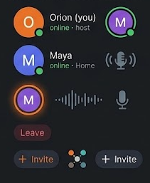
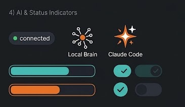
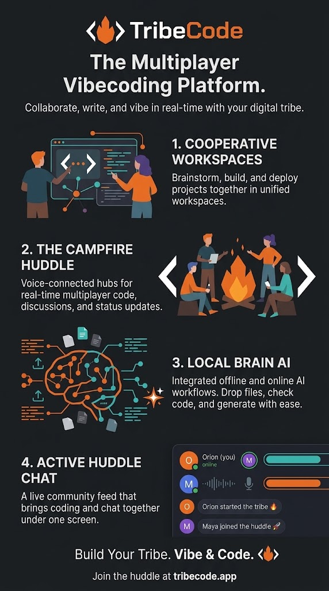
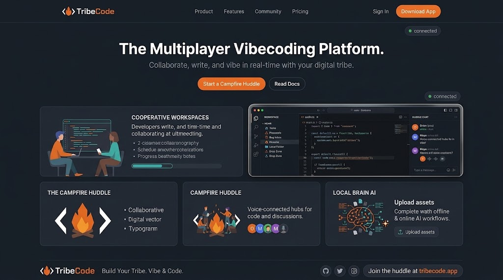

# Inspiration sheets

Reference art for TribeCode's UI. Use these when building or restyling the matching parts of the app.

| Sheet | Element | Where it goes in the app |
| --- | --- | --- |
|  | Big round avatars with an initial and a green online dot; "online · host" / "online · Home" status lines | Room panel (`#room-list`), mobile Chat tab |
| | Avatar with a thick colored ring | Huddle bar: the person speaking (ring in their color / flame orange) |
| | Mic with sound waves; waveform next to a speaking avatar | Huddle bar and room panel while someone talks |
| | Red "Leave" pill | Huddle controls |
| | "+ Invite" pills (orange-outline and neutral) and the 4-node "tribe" glyph | Invite friends button, empty room state |
|  | Dark "● connected" pill | Title bar sync status |
| | Node-network icon = **Local Brain** | Brain status in the title bar, Standup card, TL;DR labels |
| | Orange four-point sparkle = **Claude Code** | "Connect your Claude Code", agent badges |
| | Outlined progress bars (teal and orange) | Getting started checklist, agent token budget, update download |
| | Check toggles (teal on, dark off) | Setup and settings switches |
| [multiplayer-and-status-sheet.png](multiplayer-and-status-sheet.png) | Both sheets side by side | Overview |

## Marketing one-pager

Voice and naming to reuse across the README, website, store listings and onboarding:

- **Tagline:** The Multiplayer Vibecoding Platform. *Collaborate, write, and vibe in real time with your digital tribe.*
- **Pillars:** 1. Cooperative Workspaces · 2. The Campfire Huddle (voice) · 3. Local Brain AI · 4. Active Huddle Chat
- **Sign-off:** Build your tribe. Vibe & code. · Join the huddle at tribecode.app
- **Illustration style:** flat figures in navy/orange/teal, campfire between code brackets, circuit-brain with file icons and the Claude sparkle

## Website mock

Landing page direction: top nav (Product, Features, Community, Pricing, Sign In, orange **Download App**), hero "The Multiplayer Vibecoding Platform." with **Start a Campfire Huddle** + **Read Docs**, the app in a device frame, feature cards for the four pillars with flat illustrations, footer "Build Your Tribe. Vibe & Code." + "Join the huddle at tribecode.app".
