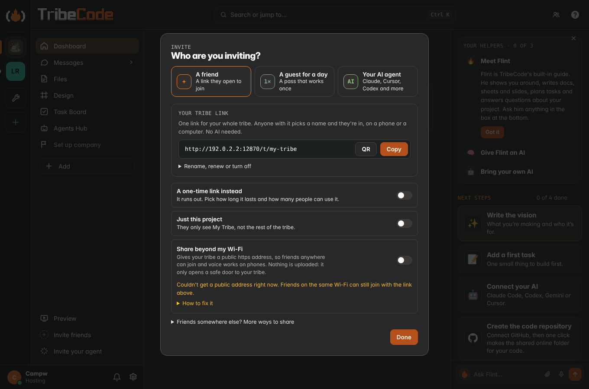

# Any LLM

Claude is no longer required. Three parts:

## 1. Bring any coding agent

Agents Hub › Your agents and the **Connect your AI** sheet offer Claude Code, Codex CLI, Gemini CLI, Qwen Code, Cursor,
Claude Desktop and any MCP client. Each tool mints its own revocable key (POST `/api/agents { kind }`); the agent is named
after its owner ("Maya's Codex"). The response carries `setup`: 2–3 steps and copy-ready blocks per place
(Anywhere / Same Wi-Fi / This computer), built by `server/agentshub.js setupFor`. The sheet polls `/api/agents/mine`
and flips "Waiting for it to connect…" to "Connected" live.

`/mcp` has always accepted `Authorization: Bearer <key>` (and still accepts `?token=`), so every tool uses the header.

Formats checked on 2026-11-07:
[Codex config.toml](https://developers.openai.com/codex/mcp) (`[mcp_servers.<name>]` `url` + `http_headers` /
`bearer_token_env_var`; `codex mcp add --url --bearer-token-env-var` from codex-rs `mcp_cmd.rs`),
[Gemini CLI](https://github.com/google-gemini/gemini-cli/blob/main/docs/tools/mcp-server.md) (`httpUrl` + `headers`,
`gemini mcp add -t http -H`), [Qwen Code](https://github.com/QwenLM/qwen-code/blob/main/docs/users/features/mcp.md)
(same schema, `qwen mcp add --transport http --header`), [Cursor](https://cursor.com/docs/context/mcp)
(`.cursor/mcp.json` `url` + `headers`).

### The TribeCode MCP page

`#/mcp` (`app/ui/mcpdir.js`) is the calm directory of everything above, like Notion's "Notion MCP" page. It opens from
Agents Hub (the **MCP** tab and "Claude.ai, ChatGPT, VS Code and more →"), the Connect your AI sheet's **See all** chip,
Settings › TribeCode MCP, and the palette. One hero ("Use your agent to drive TribeCode", Connect opens the sheet for the
tool you used last), two tabs: **Discover clients** (searchable grid, 2 columns, 1 on phones) and **Connected** (your keys
from `GET /api/agents/mine`, live/idle, Remove = `DELETE /api/agents/mine?id=`). Every Connect reuses the sheet
(`TribeApp.connectClaude({ tool })`), so each client gets its own key and its exact setup. Up to 8 keys per person.

Formats added on 2026-11-07, each from the tool's own docs:

| Client | Where | Shape |
| --- | --- | --- |
| [VS Code](https://code.visualstudio.com/docs/agents/reference/mcp-configuration) (Copilot Agent mode) | `.vscode/mcp.json` | `servers.<name>` `{ type: "http", url, headers }` (top-level key is `servers`, not `mcpServers`) |
| [Zed](https://zed.dev/docs/ai/mcp) | settings.json | `context_servers.<name>` `{ url, headers }` |
| [Cline](https://docs.cline.bot/mcp/configuring-mcp-servers) | `cline_mcp_settings.json` | `mcpServers.<name>` `{ type: "streamableHttp", url, headers }` (without `type` it falls back to SSE) |
| [Goose](https://github.com/block/goose/blob/main/crates/goose/src/agents/extension.rs) | `~/.config/goose/config.yaml` | `extensions.<name>` `{ type: streamable_http, uri, headers, enabled, timeout }` (the `headers` field is in the source, not the docs page) |
| [Continue](https://docs.continue.dev/customize/deep-dives/mcp) | `.continue/mcpServers/tribecode.yaml` | `mcpServers[]` `{ type: streamable-http, url, requestOptions.headers }` ([reference](https://docs.continue.dev/reference)) |
| Windsurf | `~/.codeium/windsurf/mcp_config.json` | `mcpServers.<name>` `{ serverUrl, headers }` |
| [Claude.ai](https://claude.com/docs/connectors/custom) | Customize › Connectors › Add custom connector | the public https URL with `?token=`, **No sign-in** |
| [ChatGPT](https://developers.openai.com/api/docs/guides/developer-mode) | Settings › Apps › Advanced settings › Developer mode › Create app | the public https URL with `?token=`, **No Authentication** |

Honest notes:
- **Windsurf**: on 2026-11-07 `docs.windsurf.com/windsurf/cascade/mcp` redirects to Devin's docs, so the `serverUrl` +
  `headers` shape could not be re-checked there; it is the shape Windsurf documented before and the card says to check
  its MCP docs.
- **Claude.ai and ChatGPT** connect from their vendors' clouds, so they only get the tribe's public https link (Tailscale
  Funnel or a Cloudflare quick tunnel, `server/share.js`); without one the page shows a note (and the host a "Turn on the
  public link" button) and Connect mints nothing. Their forms take OAuth or no sign-in; TribeCode doesn't do OAuth, so
  the key rides in the URL (`/mcp` has always accepted `?token=`). Treat that URL like a password, and Remove it on the
  Connected tab to revoke it. Claude.ai's Request headers (beta, some organizations) can carry `Authorization: Bearer`
  instead. A Cloudflare quick tunnel changes address each start, so re-add the connector then; Funnel keeps it.
- Nothing is marked "Coming soon" today: every listed client works with a Bearer header or the token in the URL.

### Apps on this computer (special connections)

`server/connections.js`, the third section of the page. A desktop app that works with a project but has no API or MCP
server, such as [ArtCraft](https://github.com/storytold/artcraft) (open-source, MIT, an IDE for AI image and video work).
A connection does two plain things: **Open** the app, and **watch** an export folder so new renders land in the project.

- ArtCraft is detected at `%ProgramFiles%\ArtCraft` (Windows), `/Applications/ArtCraft.app` (macOS), or on PATH / as an
  AppImage (Linux). Not found: paste the path (a folder is fine; the app inside it is used).
- **+ Add a special connection**: name, emoji, app path, watch folder, web link, each optional except the name.
- The watcher polls the top level of the picked folder every 3 s. New png/jpg/webp/gif/mp4/webm files (up to 50 MB, once
  they stop growing) are copied into the project's Files (`uploads.addLocal`), PNGs up to 8 MB also into Visuals, and the
  chat gets one line per batch ("🎨 2 new renders from ArtCraft"). Files already there when the folder is picked are skipped.
- Stored per project in `.tribe/connections.json`; what the watcher has seen in `.tribe/connections-seen.json`.
- Security: GET is for every member of the project (no local paths unless host). Add, edit, remove and launch need the
  host **and** a request from the host's own computer (`isLocal`); friends get 403. Launch runs only the saved path,
  `spawn(path, [], { shell: false, detached: true })` (macOS `.app`: `/usr/bin/open <app>`). The watch folder must be a
  real folder (not a symlink, not the tribe folder); symlinked files inside it are skipped. Phones and friends see the
  section read-only with "Open on the host's computer".

## 2. Flint's brain

`server/llm.js` is the one provider layer for every server-side AI feature. `brain.generate/status/refresh` are routed
through it (`brain.route`), so Ask AI, vision drafts and phrase chips, suggested tasks, doc TL;DRs, huddle notes,
standups and the Secretary all use the chosen provider. Order: chosen provider → Ollama → basic.

- Providers: `ollama`, `openai`, `anthropic`, `gemini`, `openrouter`, `groq`, `custom` (any OpenAI-compatible base URL),
  `none`. Plain `fetch`, SSE streaming, timeouts, `<think>` stripped.
- The key lives only on the host: `.tribe/secrets/llm.json`, mode 0600, skipped by backups. Never logged (errors are
  scrubbed), never in a URL (Gemini gets `x-goog-api-key`), never in an API response, `/api/health` or the WebSocket.
- `GET /api/llm` (members: no key, no URL), `PUT /api/llm` and `POST /api/llm/test` (host only).
- Friends' calls go through the host (members only). The host turns that on/off; a soft daily cap per friend; 12 Flint
  asks a minute per friend. The caller comes from an AsyncLocalStorage set per API request.
- Flint replies show who answered (`X-Flint-Via` → "via Gemini 2.5 Flash").

**Built in (browser):** `app/ui/brainpick.js` imports WebLLM from `https://esm.run/@mlc-ai/web-llm@0.2.83` only when
someone picks Built in and taps Download, then runs `Qwen3-0.6B-q4f16_1-MLC` (or `Qwen3-1.7B-q4f16_1-MLC` on a GPU with
shader-f16, 8 GB and 1 GB buffers; `q4f32_1` without f16). This CDN script is the one exception to "zero dependencies",
loaded on demand and pinned like three.js in the viewers. It needs WebGPU; without it the sheet says so and points to
the host's model or a key. The model runs entirely in the browser.

## 3. Friends without an AI

**Ask an agent** (composer + menu, the robot on a task card, Requests): `POST /api/coord/asks` queues an open hand-off
with `ask: true`. Connected agents get a note; any agent sees it in `my_lane` and takes it with the MCP tool
`take_handoff` (then `done: true`). Flint (built in, or the host's brain) answers the rest.

## 4. Invite your Claude

The one way a person's Claude joins. It is the **Your Claude** choice of the one invite sheet (`app/ui/inviteone.js`:
"Who?" → A friend · A guest for a day · Your Claude), which every invite entry opens: the sidebar rows, People, Home,
a project's menu, the create-a-tribe flow, the empty chat, Flint ("invite my claude") and Connect your AI's Claude
choices. Code: `server/inviteclaude.js`, `server/claudeauth.js`, `app/ui/inviteclaude.js`
(`TribeInviteClaude.open()`, `.mount(el)`, `.access(el)` for Settings, `.card()` for the Agents Hub).

1. It guesses which Claude (a phone gets Claude on the web, else Claude Code; your last pick is remembered):
   - **Claude Code**: one command, `claude mcp add --transport http tribecode <url>/mcp --header "Authorization: Bearer …"`.
     The stdio bridge form is under a fold.
   - **Claude Desktop**: the `claude_desktop_config.json` snippet (the stdio bridge, `scripts/mcp-stdio.js`), Copy and
     **Download config**.
   - **Claude on the web**: with a public https address, the connector address for claude.ai › Settings › Connectors ›
     Add custom connector. The address has **no key in it**: claude.ai signs in (below). Without a public address it
     explains why and offers **Work with friends anywhere** (the tunnel).
2. **Nothing is made when the sheet opens.** The setup shows with the key masked; the Claude member is made when you
   press **Copy** or **Download** (or approve a sign-in). A Claude that never connects is taken out again after 24 hours.
3. **Waiting for your Claude…** turns into **✓ Campw's Claude joined** when it first connects (MCP `initialize`). It
   posts a hello in chat and shows in People with the AI badge and "invited by Campw".

**One Claude per person.** A Claude you connected earlier with Connect your AI counts as yours: the sheet shows it as
*already connected* with its controls (narrow, Pause, Remove, New key) and never makes a second member; a new key goes
to that same member. If you have two from before (one from each feature), both keep working and show together with a
hint: **Keep only this one** on the one you use removes the other (it asks first).

**Sign-in for the claude.ai connector** (`server/claudeauth.js`). The tribe host is its own small authorization server,
following the MCP authorization spec (2025-11-25): OAuth 2.1 authorization code with PKCE (S256 only), public clients,
dynamic client registration, and the two discovery documents.

- `/mcp` without a valid key answers `401` with `WWW-Authenticate: Bearer resource_metadata="…"`.
- `GET /.well-known/oauth-protected-resource` (also `…/mcp`) and `GET /.well-known/oauth-authorization-server`.
- `POST /connect/register` (redirect URIs: https, or http on localhost; no fragments), `GET /connect/authorize`,
  `POST /connect/token` (form-encoded), `POST /connect/revoke`.
- The consent page is TribeCode's own (`app/ui/claude-consent.html`): the member signed in on that address approves
  **Let your Claude join as <name>'s Claude**. It shows the app's name and where it returns to. If that browser isn't
  signed in there (you use the app on localhost, claude.ai opened the public address), the page shows a short code;
  type it under Invite › Your Claude › Claude on the web and approve in the app.
- Access tokens last an hour, refresh tokens 30 days and rotate on every use (using an old one again ends the whole
  sign-in). Only sha256 hashes are stored (`.tribe/claude-oauth.json`). A token only works in the `Authorization`
  header, signs in as your invited Claude, and so follows every rule below. The sheet lists each sign-in with
  **Sign out**; Pause and Remove reach them too. The endpoints are rate-limited.
- The header key stays for Claude Code and Desktop (Claude Code can also sign in this way: loopback redirects on any
  port are accepted). An old `…/mcp?token=…` link keeps working for whoever has one; the sheet no longer offers it.
- Not built: Client ID Metadata Documents (the server would have to fetch a URL a stranger names). claude.ai falls
  back to dynamic registration, which is what this implements.

**Access: everything you can, never more.**

- Its key is its own member key: one per person, shown once, only its hash stored, revoked in one click.
- Every request runs as the Claude. `perms.actingRole()` derives its role from yours on every call, capped at builder,
  so it can't do admin or host things even when you are the host. If your role drops (say to spectator), it can only
  read. Its projects follow yours on every call.
- **Let it act as me for admin** (off by default, shown to hosts and admins) lifts the cap to admin: it may moderate
  (mute, remove from a project). Roles, hosting, keys, backups, invites and its own permissions stay human-only.
- It never reads DMs other than its private line with you, never decides approvals (it can ask for them), never
  invites people, mints keys or approves a sign-in. The Marketplace is read-only for it.
- **What it can do**: Chat, Docs and notes, Tasks, Files and code, Website, Ask for approvals. Unticked areas vanish
  from its `tools/list` and their tools and `/api` paths are refused. **Pause** refuses its key and its sign-ins at
  once (401); **Remove** wipes them and takes it out of People.
- Rate-limited: `TRIBE_CLAUDE_RATE` actions a minute (default 120), MCP calls and API calls alike.
- Keys and tokens never go in logs or the tribe folder.

**Alongside you.** Presence says where it is ("Campw's Claude · in Launch plan doc"). Its messages carry its name, and
you can edit or delete them like your own. MCP tools it gets on top of the usual ones: `inbox_next` (new @mentions of
it in channels it can see, plus your private messages; `@Campw's Claude` from anyone, `@claude` from you), `reply_chat`,
`react_chat`, `comment_task`, `where_is`.

HTTP: `GET|POST|PUT|DELETE /api/invite-claude` (status with `claudes`, `merge` and a masked `preview` · make or re-key ·
`{id, scopes, paused, adminAsMe}` · remove), `DELETE /api/invite-claude/connections/<id>`, `GET|POST /api/claude-auth`
(what a typed code is asking · approve or decline).
Tests: `app/test/e2e_invite_one.py`, `app/test/e2e_invite_claude.py`; security: `security4_test.py` › C and O.
