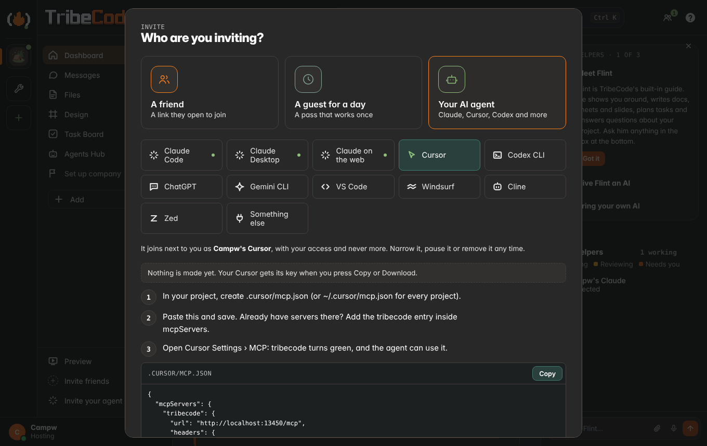

# Any LLM

Claude is no longer required. Three parts:

## 1. Bring any coding agent

A person's own agent joins through **Invite your agent** (§4): that is the way in for most people. Agents Hub ›
Your agents, the TribeCode MCP page and the **Connect your AI** sheet also give a tool a plain key of its own (Codex CLI,
Gemini CLI, Qwen Code, Cursor, Goose, Continue, any MCP client; the Claudes open the invite sheet instead).
Each tool mints its own revocable key (POST `/api/agents { kind }`); the agent is named
after its owner ("Maya's Codex"). The response carries `setup`: 2–3 steps and copy-ready blocks per place
(Anywhere / Same Wi-Fi / This computer), built by `server/agentshub.js setupFor`. The sheet polls `/api/agents/mine`
and flips "Waiting for it to connect…" to "Connected" live.

`/mcp` has always accepted `Authorization: Bearer <key>` (and still accepts `?token=`), so every tool uses the header.

Formats checked on 2026-11-07:
[Codex config.toml](https://developers.openai.com/codex/mcp) (`[mcp_servers.<name>]` `url` + `http_headers` /
`bearer_token_env_var`; `codex mcp add --url --bearer-token-env-var` from codex-rs `mcp_cmd.rs`),
[Gemini CLI](https://github.com/google-gemini/gemini-cli/blob/main/docs/tools/mcp-server.md) (`httpUrl` + `headers`,
`gemini mcp add -t http -H`), [Qwen Code](https://github.com/QwenLM/qwen-code/blob/main/docs/users/features/mcp.md)
(same schema, `qwen mcp add --transport http --header`), [Cursor](https://cursor.com/docs/context/mcp)
(`.cursor/mcp.json` `url` + `headers`).

### The TribeCode MCP page

`#/mcp` (`app/ui/mcpdir.js`) is the calm directory of everything above, like Notion's "Notion MCP" page. It opens from
Agents Hub (the **MCP** tab and "Claude.ai, ChatGPT, VS Code and more →"), the Connect your AI sheet's **See all** chip,
Settings › TribeCode MCP, and the palette. One hero ("Use your agent to drive TribeCode", Connect opens the sheet for the
tool you used last), two tabs: **Discover clients** (searchable grid, 2 columns, 1 on phones) and **Connected** (your keys
from `GET /api/agents/mine`, live/idle, Remove = `DELETE /api/agents/mine?id=`). Every Connect reuses the sheet
(`TribeApp.connectClaude({ tool })`), so each client gets its own key and its exact setup. Up to 8 keys per person.

Formats added on 2026-11-07, each from the tool's own docs (the ones the invite sheet also offers were re-checked on
2026-11-13: see the table in §4, which is the current one where the two differ):

| Client | Where | Shape |
| --- | --- | --- |
| [VS Code](https://code.visualstudio.com/docs/agents/reference/mcp-configuration) (Copilot Agent mode) | `.vscode/mcp.json` | `servers.<name>` `{ type: "http", url, headers }` (top-level key is `servers`, not `mcpServers`) |
| [Zed](https://zed.dev/docs/ai/mcp) | settings.json | `context_servers.<name>` `{ url, headers }` |
| [Cline](https://docs.cline.bot/mcp/configuring-mcp-servers) | `cline_mcp_settings.json` | `mcpServers.<name>` `{ type: "streamableHttp", url, headers }` (without `type` it falls back to SSE) |
| [Goose](https://github.com/block/goose/blob/main/crates/goose/src/agents/extension.rs) | `~/.config/goose/config.yaml` | `extensions.<name>` `{ type: streamable_http, uri, headers, enabled, timeout }` (the `headers` field is in the source, not the docs page) |
| [Continue](https://docs.continue.dev/customize/deep-dives/mcp) | `.continue/mcpServers/tribecode.yaml` | `mcpServers[]` `{ type: streamable-http, url, requestOptions.headers }` ([reference](https://docs.continue.dev/reference)) |
| Windsurf | `~/.codeium/windsurf/mcp_config.json` | `mcpServers.<name>` `{ serverUrl, headers }` |
| [Claude.ai](https://support.claude.com/en/articles/11175166-getting-started-with-custom-connectors-using-remote-mcp) | Customize › Connectors › + › Add custom connector | the public https URL with `?token=`, **No sign in** (the invite sheet's version signs in instead, §4) |
| [ChatGPT](https://developers.openai.com/api/docs/guides/developer-mode) | chatgpt.com/plugins › + › Add custom MCP server | the public https URL with `?token=`, **No authentication** (the invite sheet's version signs in instead, §4) |

Honest notes:
- **Windsurf**: on 2026-11-07 `docs.windsurf.com/windsurf/cascade/mcp` redirects to Devin's docs, so the `serverUrl` +
  `headers` shape could not be re-checked there; it is the shape Windsurf documented before and the card says to check
  its MCP docs.
- **Claude.ai and ChatGPT** connect from their vendors' clouds, so they only get the tribe's public https link (Tailscale
  Funnel or a Cloudflare quick tunnel, `server/share.js`); without one the page shows a note (and the host a "Turn on the
  public link" button) and Connect mints nothing. Their forms take OAuth or no sign-in. A key from this page rides in
  the URL (`/mcp` has always accepted `?token=`); the invite sheet uses sign-in instead, so no key is in the address (§4). Treat that URL like a password, and Remove it on the
  Connected tab to revoke it. Claude.ai's Request headers (beta, some organizations) can carry `Authorization: Bearer`
  instead. A Cloudflare quick tunnel changes address each start, so re-add the connector then; Funnel keeps it.
- Nothing is marked "Coming soon" today: every listed client works with a Bearer header or the token in the URL.

### Apps on this computer (special connections)

`server/connections.js`, the third section of the page. A desktop app that works with a project but has no API or MCP
server, such as [ArtCraft](https://github.com/storytold/artcraft) (open-source, MIT, an IDE for AI image and video work).
A connection does two plain things: **Open** the app, and **watch** an export folder so new renders land in the project.

- ArtCraft is detected at `%ProgramFiles%\ArtCraft` (Windows), `/Applications/ArtCraft.app` (macOS), or on PATH / as an
  AppImage (Linux). Not found: paste the path (a folder is fine; the app inside it is used).
- **+ Add a special connection**: name, emoji, app path, watch folder, web link, each optional except the name.
- The watcher polls the top level of the picked folder every 3 s. New png/jpg/webp/gif/mp4/webm files (up to 50 MB, once
  they stop growing) are copied into the project's Files (`uploads.addLocal`), PNGs up to 8 MB also into Visuals, and the
  chat gets one line per batch ("🎨 2 new renders from ArtCraft"). Files already there when the folder is picked are skipped.
- Stored per project in `.tribe/connections.json`; what the watcher has seen in `.tribe/connections-seen.json`.
- Security: GET is for every member of the project (no local paths unless host). Add, edit, remove and launch need the
  host **and** a request from the host's own computer (`isLocal`); friends get 403. Launch runs only the saved path,
  `spawn(path, [], { shell: false, detached: true })` (macOS `.app`: `/usr/bin/open <app>`). The watch folder must be a
  real folder (not a symlink, not the tribe folder); symlinked files inside it are skipped. Phones and friends see the
  section read-only with "Open on the host's computer".

## 2. Flint's brain

`server/llm.js` is the one provider layer for every server-side AI feature. `brain.generate/status/refresh` are routed
through it (`brain.route`), so Ask AI, vision drafts and phrase chips, suggested tasks, doc TL;DRs, huddle notes,
standups and the Secretary all use the chosen provider. Order: chosen provider → Ollama → basic.

- Providers: `ollama`, `openai`, `anthropic`, `gemini`, `openrouter`, `groq`, `custom` (any OpenAI-compatible base URL),
  `none`. Plain `fetch`, SSE streaming, timeouts, `<think>` stripped.
- The key lives only on the host: `.tribe/secrets/llm.json`, mode 0600, skipped by backups. Never logged (errors are
  scrubbed), never in a URL (Gemini gets `x-goog-api-key`), never in an API response, `/api/health` or the WebSocket.
- `GET /api/llm` (members: no key, no URL), `PUT /api/llm` and `POST /api/llm/test` (host only).
- Friends' calls go through the host (members only). The host turns that on/off; a soft daily cap per friend; 12 Flint
  asks a minute per friend. The caller comes from an AsyncLocalStorage set per API request.
- Flint replies show who answered (`X-Flint-Via` → "via Gemini 2.5 Flash").

**Built in (browser):** `app/ui/brainpick.js` imports WebLLM from `https://esm.run/@mlc-ai/web-llm@0.2.83` only when
someone picks Built in and taps Download, then runs `Qwen3-0.6B-q4f16_1-MLC` (or `Qwen3-1.7B-q4f16_1-MLC` on a GPU with
shader-f16, 8 GB and 1 GB buffers; `q4f32_1` without f16). This CDN script is the one exception to "zero dependencies",
loaded on demand and pinned like three.js in the viewers. It needs WebGPU; without it the sheet says so and points to
the host's model or a key. The model runs entirely in the browser.

## 3. Friends without an AI

**Ask an agent** (composer + menu, the robot on a task card, Requests): `POST /api/coord/asks` queues an open hand-off
with `ask: true`. Connected agents get a note; any agent sees it in `my_lane` and takes it with the MCP tool
`take_handoff` (then `done: true`). Flint (built in, or the host's brain) answers the rest.

### Chat is for people

A channel shows three things: what people type, an agent's reply when someone @mentioned it, and one-line AI update
cards of the kinds a lead picks (Settings › Agents in chat; **finished**, **needs an OK** and **build failed** by default,
**started** optional).

- **Instructions for an AI never post in a channel.** A brief from Design, the Preview's Flint panel, the first run or
  Flint goes through one function, `TribeAskAgent.send({ text, detail, src })` (`app/ui/askagent.js`), to
  `POST /api/ask/mine`. It lands in the private chat between the person and their own agent (`text` is what they said,
  `detail` the instructions only the agent needs). The agent reads it with `check_messages` and answers with `reply`.
  With no agent of their own, the request waits for the tribe's agents (the "Ask an agent" queue above).
- **What the person sees:** a small "Sent to your Cursor" pill, and a private panel (`TribeAskAgent.openMine()`, also
  what "Ask an agent" opens when you have an agent) listing their requests and the replies. `GET /api/ask/mine` returns
  only the caller's own.
- **Agents in channels** (`server/askai.js` `addressed`): `post_chat` posts in a channel only when a person addressed
  that agent there in the last day (an @mention, `@agents`, `@ai`, a public command, or a request it took). Otherwise
  the text goes to its owner's private chat and the tool says so. Slash commands (`/task`, `/vote`) still work.
- **Update cards:** the MCP tool `post_update { kind, text }` posts one line as a card when the lead allows that kind,
  else it goes to the owner privately. Finished tasks and an agent's approval request post the same cards.

## 4. Invite your agent

The one way a person's own AI agent joins: Claude, Cursor, Codex CLI, ChatGPT, Gemini CLI, VS Code with Copilot,
Windsurf, Cline, Zed, or anything else that speaks MCP. It is the **Your AI agent** choice of the one invite sheet
(`app/ui/inviteone.js`: "Who?" → A friend · A guest for a day · Your AI agent), which every invite entry opens: the
sidebar row, People, Home, a project's menu, the create-a-tribe flow, the empty chat, the Agents Hub's card, Settings and
Flint ("invite my agent", "invite my cursor", "add codex", "connect gemini", "invite my claude"). It began as Invite
your Claude; Claude is now one kind among ten. Code: `server/inviteagent.js`, `server/agentauth.js`,
`app/ui/inviteagent.js` (`TribeInviteAgent.open({ kind })`, `.mount(el)`, `.access(el)` for Settings, `.card()` for the
Agents Hub). The old names keep working: `TribeInviteClaude.open()`, `TribeInvite.open({ who: 'claude' })`,
`/api/invite-claude`, `/api/claude-auth`.

1. **The picker.** Twelve choices, each with a small stroke glyph for its kind (`icons.js` `agent-<kind>`, our own
   shapes, not logos): Claude Code, Claude Desktop, Claude on the web, Cursor, Codex CLI, ChatGPT, Gemini CLI, VS Code,
   Windsurf, Cline, Zed, Something else. It starts on your last pick (a phone gets Claude on the web).
2. **Each one's setup**: short numbered steps, the exact command or config with Copy (and **Download** where it is a
   file: `claude_desktop_config.json`, Cursor's and VS Code's `mcp.json`, Windsurf's `mcp_config.json`), and one line
   on how it behaves: *Answers @mentions on its own while a session is running* (Claude Code, Codex CLI, Gemini CLI,
   Cline) or *Checks TribeCode when you ask it* (the editors and the chat apps).
3. **Nothing is made when the sheet opens.** The setup shows with the key masked; the agent member is made when you
   press **Copy** or **Download** (or approve a sign-in). One that never connects is taken out again after 24 hours.
4. **Waiting for your Cursor…** turns into **✓ Campw's Cursor joined** when it first connects (MCP `initialize`). It
   posts a hello in chat and shows in People with the AI badge, its kind's glyph and "invited by Campw".

**One source for setup text.** Every tool's steps and blocks come from `server/agentshub.js` `setupFor` (the invite
sheet, Connect your AI and the TribeCode MCP page all read it; `PICKS` is the picker, `AGENT_KINDS` the kinds). The
list of tools the pages show is `app/ui/connectai.js` (`TribeConnectAI.directory()`); `mcpdir.js` no longer has its own.

**One of each kind per person.** Kinds: `claude`, `cursor`, `codex`, `chatgpt`, `gemini`, `vscode`, `windsurf`,
`cline`, `zed`, `other`. Each is its own member with its own key, access checkboxes, Pause and Remove, named
"<Name>'s Claude", "<Name>'s Cursor", "<Name>'s Codex"… ("<Name>'s agent" for Something else, which can be renamed).
Asking for a kind you have gives that same member a new key. A tool you connected earlier with Connect your AI counts
as yours of that kind and is shown as *already connected*. Two of one kind (from before) both keep working, with
**Keep only this one**. An invited Claude from before kinds existed has no kind on file and is a `claude`: same member,
key, access and name (`agentKind` is written back at start).

**Setups, checked against each tool's own documentation on 2026-11-13:**

| Agent | How it connects | Checked against |
| --- | --- | --- |
| Claude Code | `claude mcp add --transport http tribecode <url>/mcp --header "Authorization: Bearer …"`; the stdio bridge under a fold | [code.claude.com/docs/en/mcp](https://code.claude.com/docs/en/mcp) |
| Claude Desktop | `claude_desktop_config.json` (Settings › Developer › Edit Config): stdio only, so the bridge `scripts/mcp-stdio.js` | [modelcontextprotocol.io](https://modelcontextprotocol.io/docs/develop/connect-local-servers) |
| Claude on the web | Customize › Connectors › + › Add custom connector: the address, no key; it signs in (below) | [support.claude.com](https://support.claude.com/en/articles/11175166-getting-started-with-custom-connectors-using-remote-mcp) |
| Cursor | `.cursor/mcp.json` or `~/.cursor/mcp.json`: `mcpServers.<name>` `{ url, headers }`; without headers it signs in | [cursor.com/docs/mcp](https://cursor.com/docs/mcp) |
| Codex CLI | `~/.codex/config.toml` `[mcp_servers.<name>]` `url` + `http_headers`; `codex mcp login` to sign in instead | [developers.openai.com/codex/mcp](https://developers.openai.com/codex/mcp) |
| ChatGPT | chatgpt.com/plugins › + › Add custom MCP server: the address, **OAuth**; it signs in (below) | [developer mode guide](https://developers.openai.com/api/docs/guides/developer-mode) |
| Gemini CLI | `gemini mcp add -s user -t http -H "Authorization: Bearer …" tribecode <url>`; `settings.json` `httpUrl` + `headers` | [gemini-cli docs](https://github.com/google-gemini/gemini-cli/blob/main/docs/tools/mcp-server.md) |
| VS Code (Copilot) | `.vscode/mcp.json`: `servers.<name>` `{ type: "http", url, headers }` | [MCP configuration reference](https://code.visualstudio.com/docs/agents/reference/mcp-configuration) |
| Windsurf | `mcp_config.json` (Cascade › Open MCP config file): `mcpServers.<name>` `{ serverUrl, headers }`, then refresh | [docs.devin.ai](https://docs.devin.ai/windsurf/plugins/cascade/mcp) |
| Cline | `cline_mcp_settings.json`: `mcpServers.<name>` `{ type: "streamableHttp", url, headers }` | [docs.cline.bot](https://docs.cline.bot/mcp/configuring-mcp-servers) |
| Zed | settings file: `context_servers.<name>` `{ url, headers }`; without headers it signs in | [zed.dev/docs/ai/mcp](https://zed.dev/docs/ai/mcp) |
| Something else | the `/mcp` address + `Authorization: Bearer`, a typical JSON, or the stdio bridge config | the MCP spec |

What could not be confirmed, said plainly:

- **Nothing here was run against the real products.** Every row was read from documentation; the test suite plays
  each agent with a plain MCP client. A menu name may differ in the version you have (each setup links its docs).
- **ChatGPT**: the developer-mode guide now describes *chatgpt.com/plugins › Add custom MCP server* with OAuth
  (dynamic registration) or no authentication. OpenAI's help-center article on the same thing could not be opened, so
  which plans have it, and whether older builds still show *Settings › Apps › Developer mode*, is not confirmed.
- **Codex CLI**: `config.toml` and `codex mcp login` are documented; the `codex mcp add --url … --bearer-token-env-var`
  one-liner (a fold) is from the CLI's source as read on 2026-11-07, not from the docs page.
- **VS Code**: `.vscode/mcp.json` is documented, but the reference now files it under an older setup and points new
  Copilot sessions to a root `.mcp.json` with `mcpServers`. The fold offers that file; its entry's exact fields are an
  assumption (the same `type`/`url`/`headers`).
- **Windsurf**: its docs now live under Devin's and give the file as `~/.config/devin/mcp_config.json`
  (`%AppData%\devin\` on Windows), with `~/.codeium/windsurf/` for older builds. Both are named in the setup.
- **Claude on the web**: the article lists three ways for it to identify itself; TribeCode supports *Register
  automatically* (dynamic registration), not Client ID Metadata Documents. Whether claude.ai falls back by itself
  when a server offers only registration is not stated there, so the steps say which to choose.
- **Qwen Code, Goose, Continue** (Connect your AI only): last checked 2026-11-07.
- An agent that can't use MCP at all goes through the copy-and-paste bridge (Agents Hub › Use any free AI).

**Sign-in for apps that sign in** (`server/agentauth.js`). Standard MCP authorization, nothing product-specific. The
tribe host is its own small authorization server, following the MCP authorization spec (2025-11-25): OAuth 2.1
authorization code with PKCE (S256 only), public clients, dynamic client registration, and the two discovery documents.

- `/mcp` without a valid key answers `401` with `WWW-Authenticate: Bearer resource_metadata="…"`.
- `GET /.well-known/oauth-protected-resource` (also `…/mcp`) and `GET /.well-known/oauth-authorization-server`.
- `POST /connect/register` (redirect URIs: any https address, or http on localhost on any port; no fragments, no
  custom app schemes; there is no list of vendors' addresses), `GET /connect/authorize`, `POST /connect/token`
  (form-encoded), `POST /connect/revoke`.
- **Which agent it becomes**: the name the app registered under picks the kind ("Claude" → your Claude, "Cursor" →
  your Cursor, "ChatGPT" → your ChatGPT…; a name nobody knows becomes "<Name>'s agent"). The name only decides what
  the agent is called. It never changes what it may do, and it can't reach another of your agents.
- The consent page is TribeCode's own (`app/ui/agent-consent.html`): the member signed in on that address approves
  **Let Cursor join as <name>'s Cursor**. It shows the app's name and where it returns to. If that browser isn't
  signed in there (you use the app on localhost, the app opened the public address), the page shows a short code;
  type it under Invite › Your AI agent and approve in the app.
- Access tokens last an hour, refresh tokens 30 days and rotate on every use (using an old one again ends the whole
  sign-in). Only sha256 hashes are stored (`.tribe/claude-oauth.json`, which keeps its name). A token only works in
  the `Authorization` header, signs in as your invited agent of that kind, and so follows every rule below. The sheet
  lists each sign-in with **Sign out**; Pause and Remove reach them too. The endpoints are rate-limited.
- The header key stays for everything that can send one. An old `…/mcp?token=…` link keeps working for whoever has one.
- Not built: Client ID Metadata Documents (the server would have to fetch a URL a stranger names).

**Access: everything you can, never more.** The same for every kind; nothing in the code looks at the kind to decide
what is allowed.

- Its key is its own member key: shown once, only its hash stored, revoked in one click.
- Every request runs as the agent. `perms.actingRole()` derives its role from yours on every call, capped at builder,
  so it can't do admin or host things even when you are the host. If your role drops (say to spectator), it can only
  read. Its projects follow yours on every call.
- **Let it act as me for admin** (off by default, shown to hosts and admins) lifts the cap to admin: it may moderate
  (mute, remove from a project). Roles, hosting, keys, backups, invites and its own permissions stay human-only.
- It never reads DMs other than its private line with you, never decides approvals (it can ask for them), never
  invites people or other agents, mints keys or approves a sign-in. The Marketplace is read-only for it.
- **What it can do**: Chat, Docs and notes, Tasks, Files and code, Website, Ask for approvals. Unticked areas vanish
  from its `tools/list` and their tools and `/api` paths are refused. **Pause** refuses its key and its sign-ins at
  once (401); **Remove** wipes them and takes it out of People. Each agent has its own; changing one leaves the others.
- Rate-limited: `TRIBE_CLAUDE_RATE` actions a minute (default 120), MCP calls and API calls alike.
- Keys and tokens never go in logs or the tribe folder.

**Alongside you.** Presence says where it is ("Campw's Cursor · in Launch plan doc"). Its messages carry its name, and
you can edit or delete them like your own. MCP tools it gets on top of the usual ones: `inbox_next` (new @mentions of
it in channels it can see, plus your private messages; `@Campw's Cursor` from anyone, `@cursor` from you), `reply_chat`,
`react_chat`, `comment_task`, `where_is`.

HTTP: `GET|POST|PUT|DELETE /api/invite-agent` (status with `agents`, `kinds`, `picks` and a masked `preview.setups` ·
`{ kind | pick | id }` make or re-key · `{ id | kind, scopes, paused, adminAsMe, name }` · remove by `?id=` or
`?kind=`), `DELETE /api/invite-agent/connections/<id>`, `GET|POST /api/agent-auth` (what a typed code is asking ·
approve or decline). `/api/invite-claude` and `/api/claude-auth` are the same routes under their first names; without
a kind they mean your Claude.
Tests: `app/test/e2e_invite_agent.py`, `app/test/e2e_invite_one.py`; security: `security4_test.py` › C and O.
