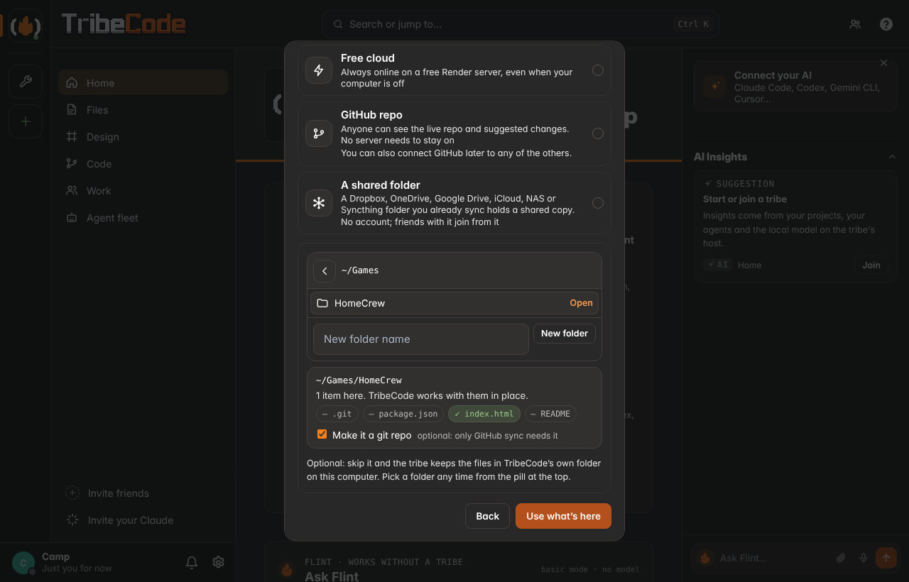
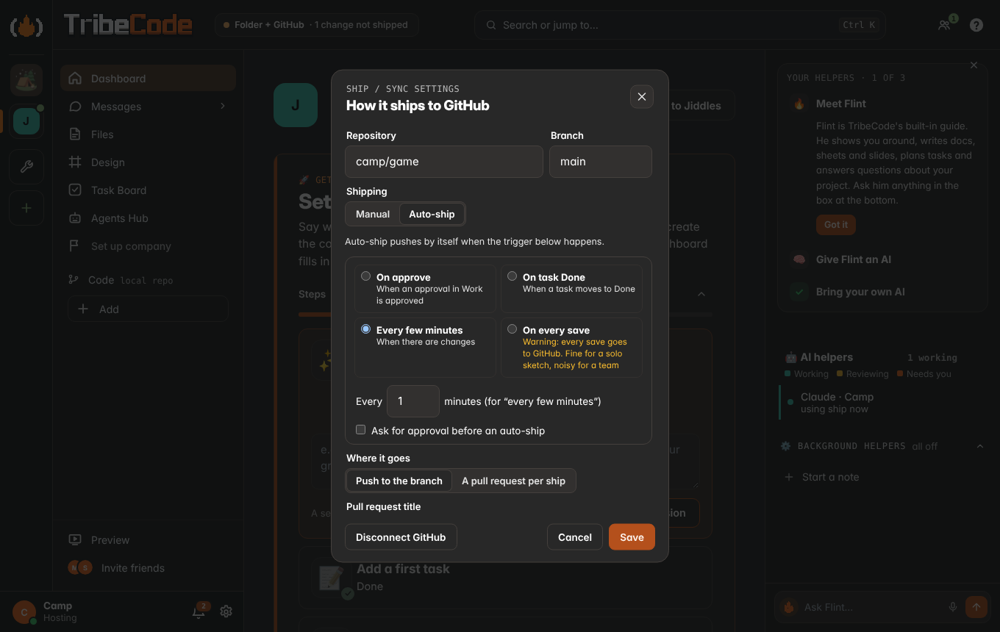
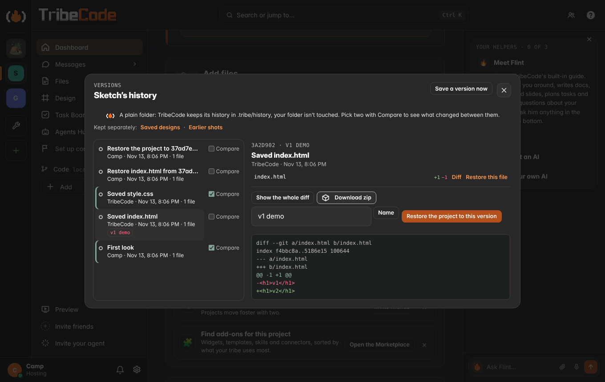

# Light hosting: local first, GitHub as the shared truth

*The assumed flow from here on (feat/setup-local).* A project starts on your device, works there with no server, and
picks a home only when you want friends in. The home can be as light as a GitHub repo.

## The flow

1. **Start, instantly.** "Start your first project" (Home, the + New project button, Move to… with no project yet)
   asks for a name, one line about it, and optionally notes, first tasks and Company basics. Create makes it at once on
   this device: tasks, docs, notes, chat, the design canvas, whiteboards and Company all work. Nothing waits on a server,
   so nothing can say "the server didn't start".
2. **Work.** Everything is kept on the device (localStorage and IndexedDB) and survives reloads. Files you make in All
   files without a project (docs, sheets, whiteboards, designs, pictures, code, any upload) are kept on the device too,
   and Move to… puts them in a project later.
3. **Choose a home: last, optional, any time.** "Where should it live?" comes after Create and stays one tap away in the
   pill at the top ("On this device · choose where it lives"):

| Home | What it gives | Needs |
| --- | --- | --- |
| **A GitHub repo** | The repo is the shared truth. Anyone can see the live repo; suggestions appear as files on a branch | A repo; a token only to write |
| **This computer** | A own tribe: friends join with a link, agents, huddles | The desktop app (or `npm start`) |
| **Free cloud** | A tribe that stays online without anyone's computer | A free Render account ([CLOUD.md](CLOUD.md)) |
| **Phone** | Keep it on this phone, or host from an Android phone | Termux for hosting ([PHONE-HOSTING.md](PHONE-HOSTING.md)) |

4. **Sync.** Choosing a server home sends the draft in one call (`POST /api/import/solo`). It is idempotent: the draft
   carries a `draftId`, the host remembers it (`solo-imports.json` in the tribe folder) and answers a repeat with the
   first result (`again: true`) instead of a second copy. The device keeps its copy until the host has answered that it
   has everything; a failure leaves the project where it was ("Try again" or "Keep working offline").

## "Lightly live on GitHub"

The minimal version, shipped now (`app/ui/setuplocal.js`):

- **Signed in?** Picking "A GitHub repo" first checks for a way to write to GitHub: a token in this browser,
  TribeCode's GitHub sign-in, the GitHub CLI (`gh auth status`) or a git credential on this computer
  (`GET /api/github/detect`, members or the host computer itself; it never returns a token). With none, a short guide:
  Sign in with GitHub (when the host turned it on), a fine-grained token (the exact steps: Contents read and write), or
  install git and the GitHub CLI for your system and run `gh auth login`. **Check again** (or coming back to the window)
  re-checks, and once something is there the GitHub sheet opens by itself. **Continue read-only** is always there.

- **Connect** a repo by name (`owner/name` or its URL). Public repos need no token to view. A fine-grained token with
  Contents read and write lets TribeCode write suggestions; it is kept only on this device (`localStorage`), never in
  the project, an export or a server.
- **Suggestions as files, no pull request.** TribeCode writes plain Markdown to a `tribe/suggestions` branch (made from
  the default branch the first time):
  - `.tribe/README.md`: what the branch is.
  - `.tribe/project.md`: the name, the one-liner, the vision and the Company basics (anything left for later says so).
  - `.tribe/tasks.md`: the task list as checkboxes by status.
  - `.tribe/docs/<slug>.md`: each doc.
  Files that haven't changed aren't written again, so mirroring is cheap and repeatable ("Mirror now").
- **The live repo on the project.** The project's Home shows a "Live on GitHub" card: the last commits, the
  `tribe/*` suggestion branches and the open pull requests, read straight from the GitHub API (cached for a minute).
  No always-on server is needed to view any of it; anyone with the link sees the same thing on github.com.

When the project later moves to a server home and the host moves it, the host clones the repo and binds it as the
project's code repository at once (the same as connecting a repo by URL: `workspaces/<project>`, `repo` + `workspace` on
the project; `server/index.js connectRepo`). It is idempotent: a repeated draft returns the first result and a project
that already has a repository keeps it. A member who isn't the host gets a chat line asking the host to connect it. The
existing workspace, autopilot and GitHub sign-in (`server/workspace.js`, `server/github-auth.js`) take over from there.

## Who keeps it live

- **Nobody, for viewing.** GitHub is the shared truth; the repo, the suggestion branch and pull requests are readable by
  anyone.
- **Any member's app, for speed.** When someone hosts (the desktop app, `npm start`), that machine is the live relay for
  chat, presence, huddles and agents. The desktop app only starts its server when a tribe exists on that computer and
  Host is on; a fresh install starts nothing.
- **A free cloud, for always-on.** Render's free plan with cloud save ([CLOUD.md](CLOUD.md)).

## After setup, when a server fails

Only once a tribe exists on this computer can Home say it is offline, and then in one line ("Your tribe is offline on
this computer. Changes wait here and send when it's back.") with **Details** (the host log), **Try again** and
**Keep working offline**. Messages and edits wait in the outbox (`app/ui/tribe.js`) and send when it is back.

## For developers

- `app/ui/setuplocal.js` (`window.TribeLocalSetup`, also `TribeSetup.start()` / `TribeSetup.where()`): the setup sheet,
  Where should it live?, the This computer sync, the GitHub connect / mirror / live card.
- `app/ui/offline.js` solo mode is the local backend: `start('solo', draft)`, Company basics
  (`/projects/:id/company`), whiteboards, `exportSolo()` (with `draftId`, `company`, `github`, doc `kind`),
  `setHome()`, `forget()`, `realFetch()`.
- `app/ui/localfiles.js` (`window.TribeLocalFiles`): files kept on the device and their editors' local backend.
- `server/soloimport.js`: the import, idempotent by `draftId`; Company basics become a company (blank template) with
  "me" seats given to the person moving it.
- `app/ui/app.js` boot: `tribeHere = hosting && (tribeHere || token)`; `hostHere({ silent: true })` returns
  `{ ok, url, role }` or `{ ok: false, error }` and shows nothing itself.
- Tests: `app/test/e2e_setup_local.py` (with a mocked GitHub), `app/test/e2e_files_local.py`.

## Folders and GitHub sync

*feat/folder-sync.* Where a project lives and its code repository are one thing: **the home is the living repo**. A
folder on this computer (or this device, the tribe's host, a cloud tribe) holds the real files; GitHub or a shared folder
is an optional synced copy on top, for any home.

### The homes (create-a-tribe step 2, the pill's "Where it lives", the steps card's "Choose where it lives")

| Home | What it is | Where it works |
| --- | --- | --- |
| **A folder on this computer** | Your own folder holds the files; this computer hosts the tribe. Recommended on the desktop app | Desktop app (native picker), or a page this computer's server serves (a picker that lists folders under home only) |
| **This device only** | Starts at once, works offline, only you see it | Everywhere |
| **Free cloud** | Always online on a free Render server | Everywhere |
| **GitHub repo** | The repo is the shared truth; "you can also connect GitHub later to any of the others" | Everywhere |
| **A shared folder** | A Dropbox, OneDrive, Google Drive, iCloud, NAS/SMB or Syncthing folder you already sync holds a shared copy | Desktop app or the host's own page |

On a phone or the public website the folder options are off, with the reason. Choosing a folder: an empty one starts
fresh; one with files offers **Use what's here** (in place, with what was found: `.git`, `package.json`, `index.html`,
README); no `.git` offers git init, optional (plain folders work without git). The folder is optional in the create
flow: skip it and the files live in TribeCode's own folder until you pick one from the pill. Files edited in
TribeCode are written straight into the folder; a watcher (debounced) shows edits from VS Code or anything else live.
**Move to another folder** copies everything into an empty folder and leaves the old one as it was.

**Path safety** (`server/folderhome.js`, every path goes through it): no `..`, real paths only (a symlink that leads out
of home, into a system folder or into TribeCode's data is refused), never a drive root, a system folder, the home folder
itself or a hidden folder in it, never TribeCode's data dir or the app, never overlapping another project's folder.
Writes inside a folder refuse `..`, absolute paths, `.git/` and any symlink on the way (`O_NOFOLLOW`). The picker and the
folder routes answer only on the host computer (a local page, no proxy headers) and only to the host.

### The pill: one status

The top bar shows one pill for the home and its sync: "Folder · ~/Games/Jiddles", "Folder + GitHub · synced 2 min
ago", "GitHub · 3 changes not shipped", "Paused", "conflict needs you" (it stands in for the Hosting pill). Its popover:
Move to a folder · Connect GitHub · Share through a synced folder · Ship now · Ship / sync settings · Versions · Share.
On the desktop it says "Delete this tribe"; "phone tribe" only on a phone.

### Shipping: manual or auto

- **Manual (default):** Ship shows what changed, a message and a target. Nothing leaves this computer until you press it.
- **Auto-ship** on a trigger: on approve (Work/approvals), on task Done, every N minutes with changes, or on every save
  (with a warning). "Ask for approval before an auto-ship" turns it into a one-tap approval first.
- **Settings:** repo and branch · push to the branch or a pull request per ship (title template `{project}: {summary}`)
  · commit message: auto-summary, Flint-written or my own · extra excludes (`.gitignore` is respected; `.tribe/` never
  ships) · pull before ship, conflicts: stop and show (default), prefer mine, prefer theirs · auto-pull every N minutes ·
  tag releases on milestones · sign as each member or as the tribe bot · pause · the ship log with **Undo last ship**
  (a revert commit, pushed; a pull request is closed on GitHub instead).
- **Who:** only the host or the project lead changes sync settings and undoes; anyone with write access ships by hand.
- **Git** runs with `execFile` and argument arrays; the token reaches git through a credential helper reading it from
  that one process's environment: never in a URL, a log or a response. MCP: `ship_status` (with the sync) and `ship_now`.

### A shared folder as the remote

No account and no network service: a bare repo `<shared>/<tribe>.tribecode.git` inside a folder your sync app already
keeps, pushed and pulled with git like GitHub, with the same ship settings. Friends who sync the same folder pick
**Join from a shared folder** (create-a-tribe, the pill, Invite) and choose the copy. Cloud-sync quirks: before every
fetch and push TribeCode looks for a half-synced repo (lock files, a missing HEAD/objects/refs, "conflicted copy" or
`.sync-conflict-` leftovers, an unreadable repo), waits and looks again, and writes nothing while it looks mid-sync;
git's own ref locks guard the push, and the push is verified afterwards (`ls-remote`).

### Sharing: four paths, one sentence each

**Work with friends anywhere** (recommended: a GitHub repo + TribeCode's invite link, guided: connect the repo, pick
manual or auto-ship, copy the invite) · **Share on this network** (friends on the same Wi-Fi join this computer's host by
link or QR, no GitHub) · **Share through a folder you already sync** · **Just me for now**. In the pill, the steps card
and the project's Invite; switch any time.

### Versions

One panel (the pill, the project's right-click menu and switcher, Ctrl K "Versions"): a timeline of saves and ships
(who, when, message, files; shipped ones marked; the website designer's saved versions in the same list). For each
version: the diff, restore a file, restore the whole project (always as a new version, nothing thrown away), name it
("v1 demo"), compare two, download a zip. A folder with `.git` uses its own history; a plain folder gets a private one in
`<folder>/.tribe/history` (saves and outside edits become versions by themselves; the folder never becomes a git repo).

### For developers

- Server: `server/folderhome.js` (picker, checks, writes, watcher, moves), `server/sync.js` (settings, ship, pull,
  conflicts, undo, triggers, shared folders, MCP), `server/versions.js`. Routes: `/api/folders/*`,
  `/api/projects/:id/folder*`, `/api/projects/:id/sync*`, `/api/projects/:id/versions*`.
- UI: `app/ui/livingrepo.js` (`window.TribeHome`: the pill, folder/GitHub/shared/sync/ship/share sheets; Settings ›
  Projects & sync through `TribeSettings.addSection('projects', …)` when it exists), `app/ui/versions.js`
  (`window.TribeVersions`), `app/ui/tribenew.js` (the homes).
- Tests: `e2e_folder_home.py`, `e2e_ship_sync.py` (a bare repo plays GitHub and a temp dir plays Dropbox),
  `e2e_versions.py`, `security4_test.py` (H). Test hooks: `TRIBE_GITHUB_GIT`, `TRIBE_GITHUB_API`, `TRIBE_SYNC_TICK_MS`,
  `TRIBE_SYNC_MINUTE_MS`, `TRIBE_SYNC_SAVE_MS`, `TRIBE_SYNC_RETRY_MS`, `TRIBE_WATCH_DEBOUNCE_MS`, `TRIBE_VERSIONS_SAVE_MS`.
