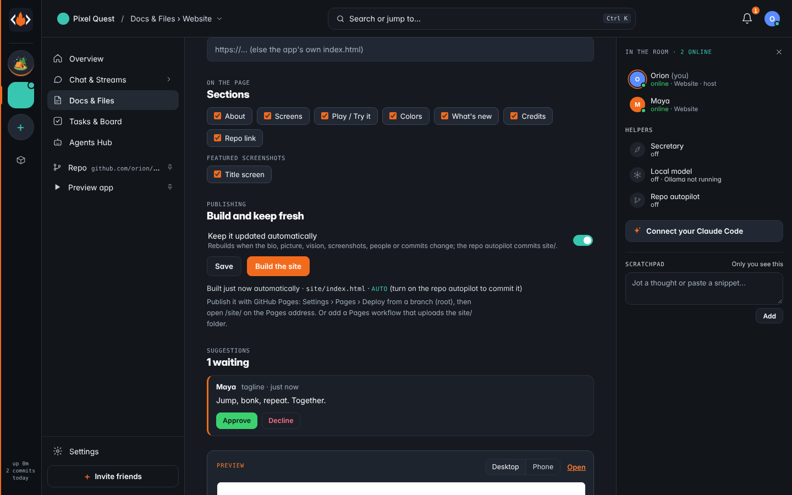
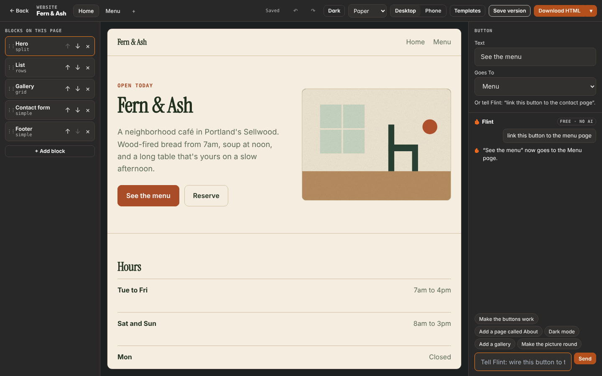

# Website

Every project (a game, an app, anything) gets its own public page, made from what the project already has.
Open it from **Files › Website** (`#/docs/website`). Once the page exists, **Website** also gets its own row in the project sidebar.

## What goes on the page

One self-contained `site/index.html` in the project's repo (projects without a repo: `projects/<id>/site/` in the tribe folder).
It needs no JavaScript, uses semantic HTML, follows the reader's light or dark setting and fits phones.

| Part | Where it comes from |
| --- | --- |
| Name, headline, tagline | The project name and bio, or the text the team sets |
| Logo and favicon | The project picture (else its emoji or initials on the project color) |
| Colors | The project color plus flat tints (primary, tint, shade, canvas, paper). No gradients |
| About | `VISION.md` (headings and markdown marks removed), or custom text |
| Screens | Up to 6 featured screenshots from Visuals, copied to `site/shots/` |
| Play it / Try it | A link the team sets (https), else the app's own built `index.html` in the repo |
| Code on GitHub | The repo's `origin` remote, https form only |
| Made by | People with their roles, agents, and commit authors. Names only, never emails |
| What's new | Recent gists, else recent commits |

Each part can be switched off under **Sections**.

## Keep it updated automatically

Turn on **Keep it updated automatically** and the page rebuilds whenever the bio, picture, vision, screenshots,
people, roles or commits change (checked every few seconds; the file is written only when it changes).
When the repo autopilot is on, TribeCode also commits `site/` (only that folder) as "TribeCode: update the website"
and pushes it, under the same rules as the autopilot's other files: only on main and only when in sync with origin.

## Suggestions

Anyone in the project (not spectators or agents) can **Suggest an edit** to the headline, tagline, about text or footer.
Chat says "💡 Maya suggested a new tagline for the website" and the host or the project lead gets a notification.
The host or lead approves (the text is applied and the page is rebuilt) or declines. Everyone else sees the fields read-only.

## Publishing

TribeCode never calls GitHub's write APIs for this. GitHub Pages publishes from the repo root or `/docs`, so either:

- **Settings › Pages › Deploy from a branch (root)**, then open `/site/` on the Pages address, or
- add a Pages workflow that uploads the `site/` folder.

## Safety

- Everything on the page is HTML-escaped (a bio with `<script>` shows as text). The repo link must be https.
- The in-app preview (`GET /api/projects/:id/website/preview`) inlines the screenshots and is served with
  `Content-Security-Policy: default-src 'none'; img-src data:; style-src 'unsafe-inline'; … sandbox`, `nosniff` and
  `no-store`. Iframes and new tabs use a signed preview token (the member's key never goes in a URL), and the iframe is
  sandboxed with no scripts and no same-origin access.

## In the preview: Flint edits it, no AI needed

The preview's bar has **App | Website**. Website shows the builder's draft (a sandboxed frame with TribeCode's own helper,
so you can click to select, double-click to type over words, and drop comment pins). Flint sits beside it (Edit on phones)
and understands plain sentences with no AI (`app/ui/siteedit-core.js`, shared with `server/siteflint.js`):

| Say | It does |
| --- | --- |
| make the headline say Fresh bread daily · change the tagline to … · the button says … | changes those words |
| click something, then type the new words (or "change it to …") | replaces exactly those words |
| change the accent to teal · make the main color blue · use #2A8C80 for the accent | brand colors (host or lead) |
| add a pricing section · add testimonials · remove the FAQ · move the FAQ to the top | sections (pricing and testimonials start with honest placeholders) |
| swap to the Studio template · use the Swiss layout · use the playful font | a look, a layout, a font pair |
| add my logo | asks for the file (PNG, JPG or plain SVG, under 200 KB) |
| undo · save this version as Before the launch | steps back · saves to Saved designs |

Every change pushes an undo step and is kept as a version; the preview reloads in place (scroll kept). With an AI on
(Claude via the host's key, or a local model through `server/llm.js`) a sentence the rules don't know becomes the same
operations, checked the same way, and the reply says **✦ via …** instead of **Basic · no AI**.

**Saved designs** (Saved in the bar; the Saved tab on phones; Files › Website › Saved designs; the project's whole history is Versions): save the draft with a
note, see a flat thumbnail of each version, compare one with now (both thumbnails and the changes in words), restore it.
Stored in `.tribe/website/<id>.versions.json`. Phones: Page · Edit · Saved tabs (tap or swipe), the device toggle shows
the desktop page shrunk to fit with pinch-to-zoom (double-tap fits it again). Test: `app/test/e2e_preview_polish.py`.

`POST …/website/flint { ask, pick?, ops?, logo? }`, `POST …/website/undo`, `GET|POST …/website/versions`,
`POST …/website/versions/:vid/restore`, `GET …/website/versions/:vid/compare`, `DELETE …/website/versions/:vid`,
`GET …/website/draft?pt=&edit=1` (the draft with the preview helper).

## The website designer

Open it from **Files › Website › Open the designer**, **Preview › Website › Design**, the project's Website link (it
goes to Files › Website), "open the website designer" in Flint's chat, or `#/site-designer`. It follows OpenPage's model
(github.com/buildingopen/openpage, MIT; reimplemented in plain JS, credited in `NOTICE`):

- **One JSON config** is the source of truth (`app/ui/sitecfg.js`): `{ name, theme: { preset, mode, colors, fonts,
  radius }, pages: [{ title, slug, blocks: [{ id, type, variant, props }] }] }`. Stored in `.tribe/website/<pid>.config.json`
  (`GET|PUT /api/projects/:id/site-config`); with no tribe it stays on this device.
- **Blocks** with layout variants, the same set tribecode.org has: hero (center, split, minimal), features (grid, list,
  stats), gallery (grid, masonry, strip), pricing (cards, table), testimonials, FAQ, team, links (link in bio), list
  (menu, dates, episodes), contact form, video/embed, text, footer, and a menu across pages. **+ Add block** picks a type
  and a variant; drag (or ↑ ↓) to reorder.
- **Themes**: eight presets (Paper, Swiss, Editorial, Terminal, Playful, Minimal, Bold, Soft). **Dark** switches to the
  design's own dark variant (a real palette, checked for contrast), not a filter.
- **Inline editing**: click words in the live preview and type. Click a button to choose where it goes (a page, a
  section, a web address, an email). Click a picture to upload one, take one from the inspiration board, make it round
  or square, and set alt text.
- **Undo / Redo** for everything (Ctrl Z, Ctrl Shift Z), including what Flint does.
- **Download HTML**: one standalone `index.html` with every page (CSS `:target`, no scripts, pictures inside). The ▾
  menu has a **zip** (a file per page, `assets/`, `fonts/`, `site.json`, README) and **Publish to the project** (writes
  the same files to `site/`, `POST …/site-config/publish`).
- **Saved designs**: Save design puts the config in Saved designs with a thumbnail; Restore brings it back
  (`server/siteflint.js` keeps `cfg` on each version).
- **The 16 templates** open as configs (`GET /api/site-designer/template/:id`, pictures inlined).

**v2 (feat/site-v2)**: the gallery has 48 templates with thumbnails, categories, search and Peek (32 imported from
Start Bootstrap, Tailwind Toolbox and HTML5 UP: docs/SITE-TEMPLATES.md), plus Import HTML. More of OpenPage is ported
(docs/OPENPAGE-PORT.md): newsletter, call to action, stats, logo cloud, banner, divider and image blocks, more variants,
section backgrounds and spacing, duplicate and hide, ten more themes, font pairs, the Site panel (page title, description,
favicon, logo, share image, language), Desktop · Tablet · Phone and keyboard shortcuts (`?`).

- **Filled from your project**: inside a project a template is filled from what TribeCode knows (the name and bio, the
  vision, members and roles, open tasks and milestones, opening hours, dates, links, email and address from chat, the
  inspiration board's accent and pictures, the logo; `GET /api/projects/:id/site-autofill`, local extraction in
  `aibasics-core.siteFacts`). A note says what was used; **Start blank instead** takes it back. With an AI on, it also
  writes the headline.
- **Comments**: Comment (or C, or the preview's Comment in Website mode) and click a section; pins show in the preview,
  the list is under Comments. After three, Flint offers to turn them into tasks: one per section, linked to the block,
  assigned per the task mode (Lead: to whoever has been editing, to accept; Council: open to claim). Finishing the task
  resolves its comments. `…/site-comments`, MCP `site_comments`, `site_comments_to_tasks`.
- **Never loses edits**: each change goes to a local draft at once and to the host after 0.6 s with the rev it started
  from; switching tabs, routes, closing or reloading flushes it; opening restores a newer draft. "Saved · just now". A
  stale save gets 409 and the choice Keep mine · Keep theirs · Keep both (theirs goes to Saved designs).
- **The Website row** shows in the project's sidebar as soon as a draft exists, with a dot while edits are not on the
  host, and opens the designer.
- **Flint, anywhere**: "link tree website" (and every other website ask) opens the designer with the template, from
  Flint's chat with or without a tribe, a project, the canvas or the preview. Building it into the repo as code is now only
  "build the website into the repo". Test: `app/test/e2e_site_v2.py`.

Flint edits the same config, free and undoable: "make the buttons work", "link this button to the contact page",
"add a page called About", "rename this page to Work", "replace the image", "use a picture from my board", "make the
picture round", "dark mode", "add a gallery", "move the FAQ to the top", "make the hero split", "use the swiss theme",
"make the accent teal", "change the headline to …", "download the html", "something for my band". What needs an AI gets
the one AI-boost card (Use my AI · Get credits / Premium). Test: `app/test/e2e_site_designer.py`.

### Style, Check, the section bar and "Have my agent do it" (`app/ui/sitestudio.js`)

- **Better pages out of the box.** Sections alternate a quiet tint, a one-page site gets a menu of its sections and a
  call-to-action, lists without text become tick lists, and there are three more blocks: Steps, Visit us (address, hours,
  phone, a directions button) and Timeline. Features can carry icons (about 90 from Lucide, inline in the export).
- **In the preview.** The section under the pointer shows a small bar: drag the grip to move it, or move up/down,
  duplicate, add a section below, remove. Click an icon to swap it. Every action is one undo step.
- **Style** (right panel). A look, the main colour, the font pair, corners, spacing and light/dark each restyle every
  page in one tap. Two more font pairs (DM Serif Display, Outfit; SIL OFL).
- **Brand kit.** "Save this look as the brand kit" keeps logo, colours, fonts and "how we sound" in one record per
  project (`GET|PUT /api/projects/:id/brand`, `app/ui/brandkit.js`; on the device when there is no tribe). The Design
  canvas shows the kit's colours first in its colour picker, and agents get the kit in `site_read`.
- **Check** ("Check my site"). `TribeSiteCfg.check(cfg)` lists problems in plain words: low contrast, buttons that go
  nowhere, pictures with no description, no description for search, empty pages and sections, example words left in,
  forms that do nothing yet, things wider than a phone (measured in a hidden 390px frame). Safe ones have a one-tap fix;
  "Fix N for me" applies them all as one undo step.
- **Have my agent do it.** The button sends the ask to the person's agent (the ask queue). The agent uses two MCP tools:
  `site_read` (the site as an outline: pages, sections with ids and words, no pictures) and `site_propose` (a list of
  safe steps: text, add, remove, move, variant, style, link, alt, theme, palette, accent, fonts, space, radius, page,
  rename, seo). `TribeSiteCfg.applyOps` checks every step; pictures, scripts and unknown fields are skipped. Nothing
  changes until a person taps Apply in the designer (an agent cannot answer its own proposal); Apply is one undo step.
  With no agent, the same sheet hands the ask to Flint.

- **One brand record.** The kit is the only brand record. The project page's older fields (`/website/brand`: primary,
  wordmark, logo, font) are a copy of it: an older project is moved into a kit the first time it is read, the older
  route answers from the kit, and a change through either route lands in both (`kitGet`, `kitSet`, `kitSync` in
  `server/showcase.js`). The canvas lists the kit's fonts and has "Use the logo here"; Design flow's poster and logo
  starters take the kit's colour, heading font and logo.
- **Illustrations.** Eight original flat scenes (`TribeSiteCfg.ILLUS`, MIT like the app) drawn in the site's own
  colours. Click a picture, then pick one under Illustrations; Check offers one for a grey placeholder; an agent may
  use the step `illustration { block, path?, name }` (the only picture step there is).
- **More site types.** Conference / meetup, Restaurant menu, Class or course, Club or group
  (`scripts/dev/site-types.json`, written as designer configs; `python3 scripts/dev/site-gallery.py --only <ids>`
  rebuilds `app/ui/sitetpl/<id>.json` and the thumbnails; run it for the 16 as well after changing how they convert).

Test: `app/test/e2e_site_studio.py`.

## API

| Method | Path | Who |
| --- | --- | --- |
| GET | `/api/projects/:id/website` | members: state, defaults, suggestions, preview link |
| PUT | `/api/projects/:id/website` | host / lead: `{ auto, sections, fields: { headline, tagline, about, footer, playUrl }, shots }` |
| POST | `/api/projects/:id/website/build` | builders |
| GET | `/api/projects/:id/website/preview[?pt=]` | members, or a signed preview token |
| POST | `/api/projects/:id/website/suggest` | `{ field, text }`, members (not spectators) |
| POST | `/api/projects/:id/website/suggestions/:sid/approve` · `/decline` | host / lead |

Code: `server/showcase.js` (not `server/site.js`, which is TribeCode's own GitHub Pages friend links), `app/ui/website.js`,
`app/ui/website.css`. Test: `app/test/e2e_website.py`.

## TribeCode's own website (tribecode.org)

Everything above is the page each *project* gets. TribeCode's own site is the `site/` folder: the Pages workflow
(`.github/workflows/pages.yml`) publishes it at the root with the web app under `/app/`.

### Why TribeCode (the plan for the home page's `#why` section)

What sets TribeCode apart from Lovable, Bolt, Replit, v0, Cursor, Discord and Notion. Each tool there is very good at
one slice: an AI that writes an app from a prompt (Lovable, Bolt, v0, Replit), an AI editor for one coder (Cursor),
a group chat (Discord), a wiki (Notion). We only claim what is built today.

| # | Differentiator | Why it's true (what's built) | Visual |
| --- | --- | --- | --- |
| 1 | **A team that includes AIs.** Friends and the AI helpers they already use (Claude Code, Codex, Gemini, Cursor) in one chat; any task can go to a person or to someone's agent, and people approve what lands. | chat + agents, lanes, hand-offs, one-tap approvals (`server/coord.js`, `approvals.js`) | the phone task list with "Give to Claude" |
| 2 | **Works with no AI, better with one.** Flint builds a website from 16 templates, a to-do app, a video editor, a platformer and company docs with no model; with an AI on, the same buttons get the ✦ version. | `server/flintfree.js` recipes, `doctpl.js`, DESIGN-SYSTEM §11 | Chore Wheel, built from one sentence |
| 3 | **You own it, and it's free.** Runs on your computer or server; chat, docs and tasks are plain Markdown/JSONL; code in your GitHub repo; MIT. Paid plans (later) only cover hosting and AI credits (docs/PREMIUM.md). | the tribe folder layout | a real tribe folder tree |
| 4 | **App, website, company and game in one project.** | Watch Flint build makes all of them in one project | four renders from one run |
| 5 | **Proof of work.** Watch Flint build shows each step, then exports ZIPs with every file, the timeline and who was there. | `flintrun.js`, `server/flintrun.js` | the finished run |
| 6 | **Your phone is a real seat.** A phone browser can chat, approve a merge, send a voice note and take a task, no app store. | docs/MOBILE.md, PWA | the phone approval card |

Not claimed: hosted plans and AI credits (not live yet), native store apps, anything a stronger AI does on its own.

### The gallery (`#gallery`)

A balanced, filterable gallery (All · Apps · Websites · Docs & company · Design · Games, `site/showcase.js`): a wide
Watch Flint build card with what's inside its proof ZIP, then apps, websites, company templates, designs and, last,
two games. Every thumbnail is a real render made by `python3 scripts/dev/showcase-thumbs.py` (a throwaway tribe,
Watch Flint build, Flint's own free commands, the templates) into `site/assets/showcase/*.webp` + `proof.json`.

Each card's **Make this** opens the app ready to make it:

- `app/?ask=<sentence>`: Flint opens with that sentence typed in (never sent for you), e.g. `make a cafe website`.
  The build sentences are Flint's free recipes; `app/test/e2e_site_gallery.py` checks each one with
  `flintfree.classify`.
- `app/?make=doc:<id>`: Work › Templates opens that company template (works with no tribe).
- `app/?flintrun=1` (Watch Flint build), `app/#/hub/work` (Work), `app/?demo=showcase` (the demo tribe).

Handled by `app/ui/makelink.js`.

### Languages

`site/i18n.js` + `site/lang/<code>.json` (es, pt, fr, de, ja, zh, ko; English is the source). Every visible string
on every page is keyed by its English text; animated app mocks, code and names stay as they are. `TribeLang.missing()`
lists what has no translation, and `app/test/e2e_site_i18n.py` fails on any (`--dump file.json` lists them to
translate).
